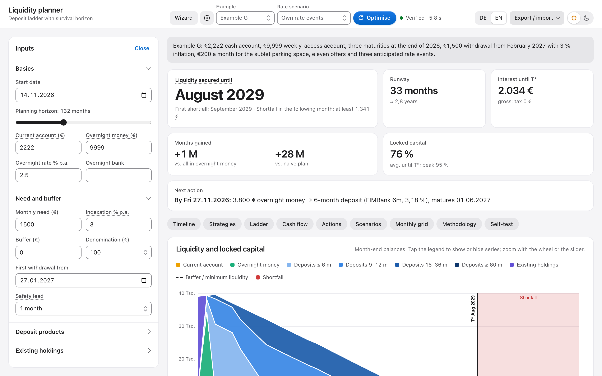
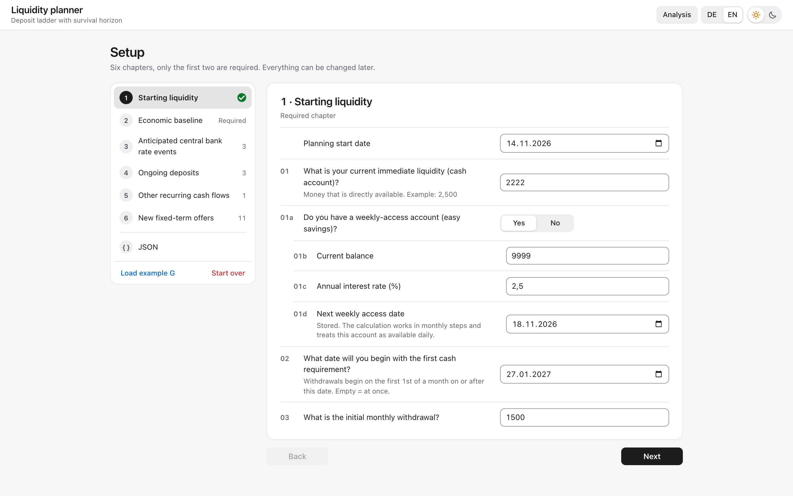
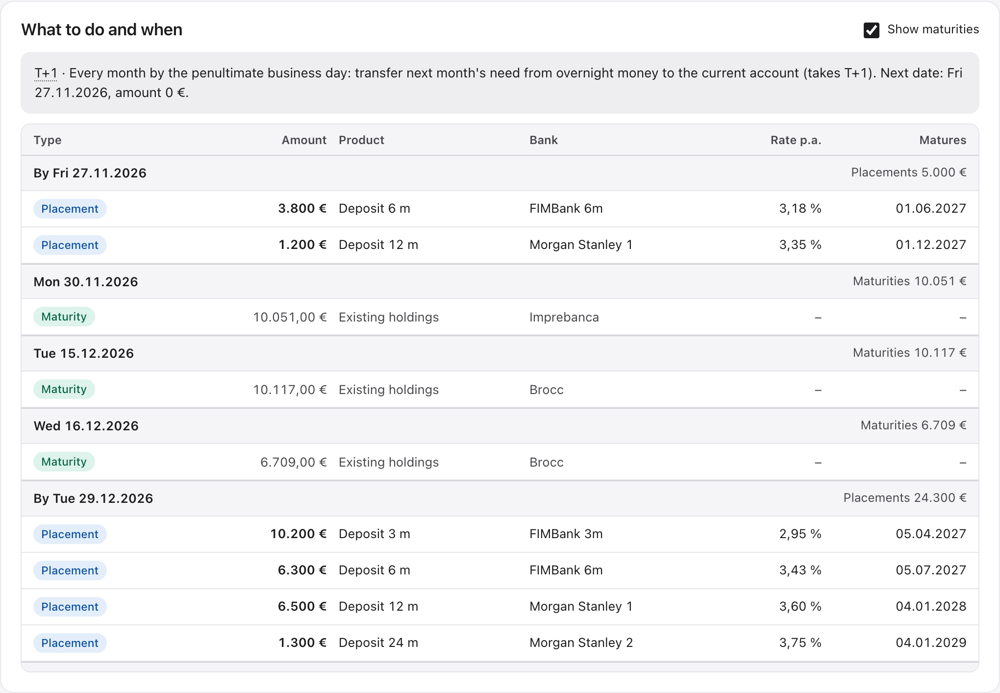
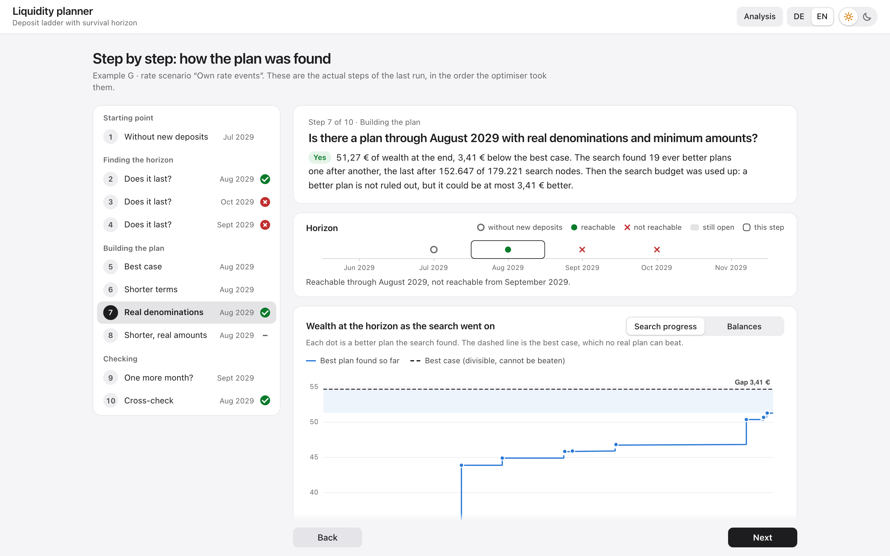
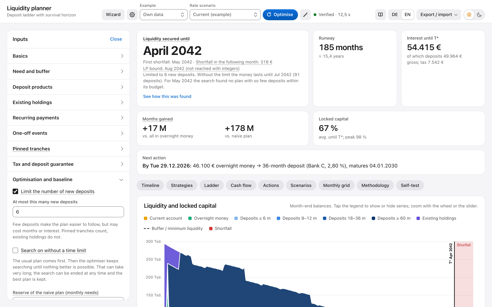
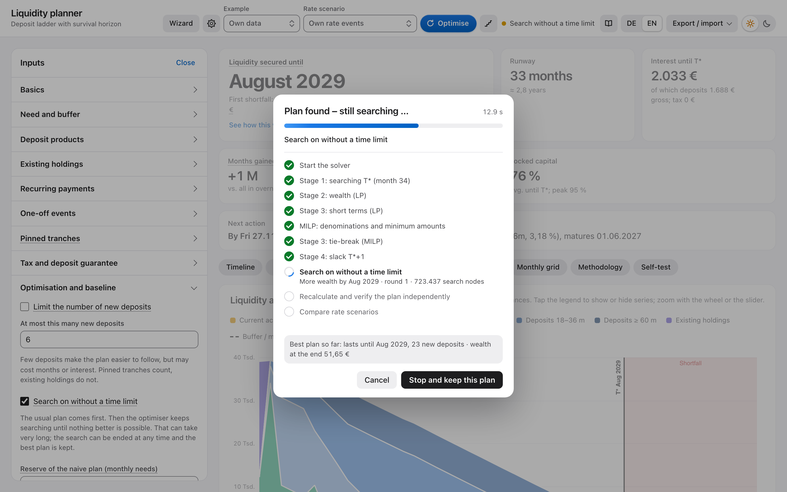
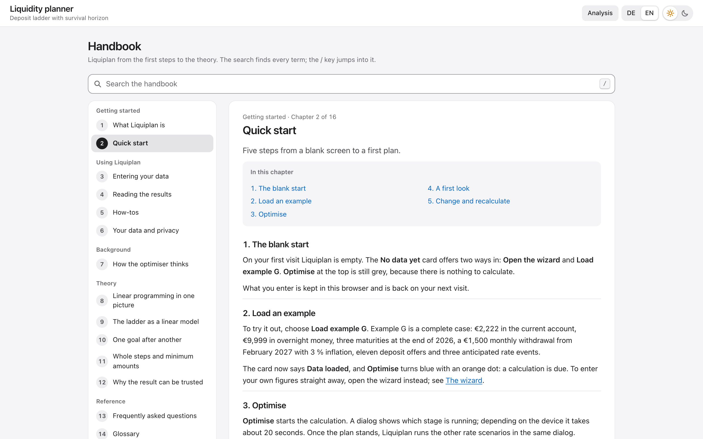
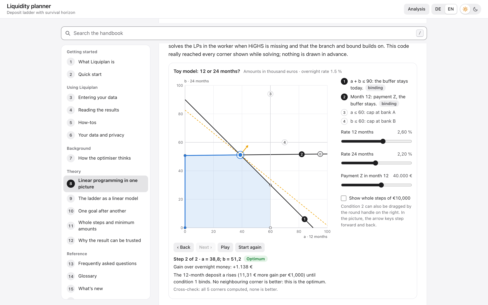
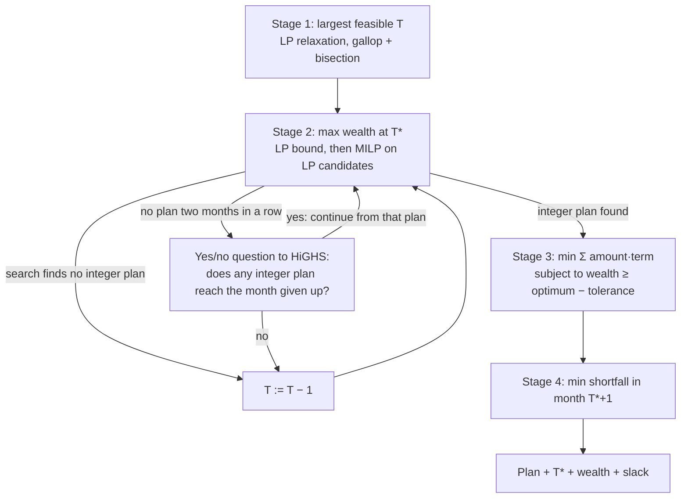
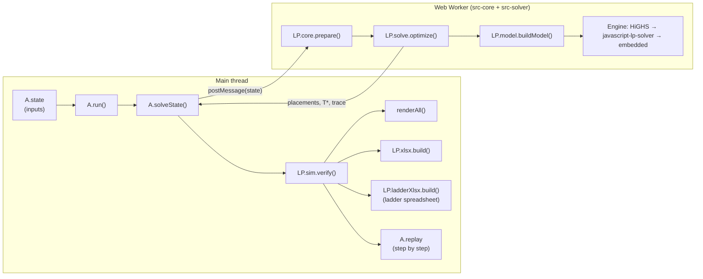

# Liquiplan: a deposit ladder planner

**Liquiditätsplaner – Festgeld-Leiter mit Überlebenshorizont** (German UI by default, English at the click of a button)

A single-file web app that answers one question: **how long will my money safely last, and which fixed-term deposits should I buy, and when, to make it last as long as possible?**

**[▶ Open the app](https://julianhilgemann.github.io/liquiplan-app/)** · nothing to install, no account, everything runs in your browser.

<!-- changelog:version (written by `node scripts/changelog.mjs` from src/app/i18n/changelog.js: edit that file, not these lines) -->
**Version 1.5** · 24 November 2026 · [What's new](#whats-new)
<!-- /changelog:version -->



> **Not financial advice.** Liquiplan is a hobby project. Its results are model calculations with simplified assumptions and illustrative rates. Read the [disclaimer](#disclaimer) before relying on anything it shows.

## Contents

- [What's new](#whats-new)
- [What it does](#what-it-does)
- [Using the app](#using-the-app)
- [Glossary of German terms](#glossary-of-german-terms)
- [How the optimisation works](#how-the-optimisation-works)
- [Code guide](#code-guide)
- [Function reference](#function-reference)
- [State format](#state-format)
- [Dependencies and deployment](#dependencies-and-deployment)
- [License](#license)
- [Disclaimer](#disclaimer)

---

## What's new

<!-- changelog:latest (written by `node scripts/changelog.mjs` from src/app/i18n/changelog.js: edit that file, not these lines) -->
### 1.5 · Few deposits and a search without a time limit

*24 November 2026*

- **New:** Limit on new deposits: under Inputs → “Optimisation and baseline” the number of new deposits can be limited to any whole number. The optimiser then looks for the plan with at most that many deposits that lasts longest, and the “Liquidity secured until” tile names what the simplicity costs. Pinned tranches count. In example G four deposits instead of 23 reach the same last month.
- **New:** Search on without a time limit: if wanted, the optimiser keeps searching after the usual plan, in rounds with ever larger budgets, until no better plan is possible. The dialog shows the round, the search nodes and the best plan so far; “Stop and keep this plan” ends the search and keeps it.
- **Improved:** Step by step, the self-test, the methodology and the handbook know both settings. The inputs group “Solver and baseline” is now called “Optimisation and baseline”.

<details>
<summary>Before that: 1.4.2 and 1.4.1</summary>

### 1.4.2 · Handbook: gap above the search closed

*24 November 2026*

- **Fixed:** Handbook: a hairline gap remained between the title and the search, and the chapter’s text showed through it while scrolling. The title and the search now meet without a gap.

### 1.4.1 · Interest: what the figure includes

*22 November 2026*

- **Improved:** Tile “Interest until T\*”: below the total it now says how much of it comes from deposits. The rest is interest on overnight money.
- **Improved:** Ladder spreadsheet: a line at the top says that the workbook holds fixed-term deposits only and leaves out the interest on overnight money. The list of tranches therefore starts one row lower.

</details>

All 8 releases since 1.0 (14 November 2026): [CHANGELOG.md](CHANGELOG.md).
<!-- /changelog:latest -->

## What it does

You describe your situation:

- **liquid money**: a current account (*Girokonto*) and an overnight/weekly-access account (*Tagesgeld*) with its rate,
- a **monthly need** that starts on a given date and rises yearly with inflation,
- other **recurring cash flows** (rent income, pension, insurance, …) and **one-off events** (a new roof, a car, a maturing life insurance),
- fixed-term deposits you **already hold**, and
- a list of **deposit offers** (term, rate, bank, minimum and maximum amount, interest convention).

The app builds a **deposit ladder** (*Festgeld-Leiter*): a schedule of placements whose maturities arrive just in time to pay the monthly need, while everything that is not needed soon earns more than overnight money. It optimises **lexicographically**, one goal strictly after the other:

1. **Maximise the survival horizon T\***: the last month up to which every month is covered without liquidity falling below the buffer.
2. **Maximise wealth at T\*** (liquidity plus open deposits including accrued interest) without giving up a single month of T\*.
3. **Prefer shorter terms** among plans with the same wealth, which keeps money flexible.
4. **Report the shortfall** in month T\*+1, so you know how much is missing for one more month.

Interest is a secondary goal by construction: it can never shorten T\*. There is no weighted sum of goals and no greedy heuristic doing the optimising. Every plan is re-computed by an independent simulator before it is shown.

Two optional settings shape the search. A **limit on the number of new deposits** asks for a simple plan: the best ladder often has one small deposit per month (23 in example G, 91 in the retirement example), and with a limit of, say, six the optimiser looks for the best plan with at most six, and says what the simplicity costs. A **search without a time limit** keeps improving the plan after the usual result, in rounds with ever larger budgets, until nothing better is possible or you stop it and keep the best plan found.

| Section | What you see |
|---|---|
| **KPIs** | T\*, runway in months, months gained against two baselines, interest until T\* (overnight money and deposits, with the deposits' share below), share of locked capital, the next action to take. With a limit on new deposits the first tile says what the limit costs |
| **Timeline** | Month-end balances as stacked areas: current account, overnight money, deposits by term bucket, existing holdings, buffer line, shortfall zone |
| **Strategies** | Optimised plan vs. "everything in overnight money" vs. a naive rate chaser, as available liquidity or total wealth |
| **Ladder** | One bar per tranche from placement to maturity, per year or for the whole horizon; tap a bar for details. *Download* saves the ladder as a small spreadsheet for Excel and Google Sheets |
| **Cash flow** | Waterfall per year or month: opening balance, income, need, other expenses, placements, deposit repayments, overnight interest, tax, closing balance |
| **Actions** | A dated to-do list: order deadlines, value dates, maturities, and the monthly transfer to the current account |
| **Scenarios** | The whole optimisation re-run and re-verified under each interest-rate scenario |
| **Monthly grid** | Month-by-month table. Extra need, extra income and a minimum liquidity can be overridden for single months |
| **Step by step** | The decisions the optimiser took for the plan on screen, one at a time: each question and its answer, the months asked about so far, the plan at that step as month-end balances (or the progress of the integer search), and the linear system behind it |
| **Methodology / Self-test** | The model explained inside the app, and a button that tests solver, simulator, the limit on new deposits, Excel export and ladder spreadsheet against each other |
| **Handbook** | A page of its own with sixteen chapters, from a quick start to five theory chapters with formulas and an interactive simplex chart, plus frequently asked questions, the glossary and *What's new*; a search finds every word |

<table>
<tr>
<td width="50%"><br><sub>Start: a blank slate with two ways in, and the handbook</sub></td>
<td width="50%"><br><sub>Data loaded: Optimise is now active</sub></td>
</tr>
<tr>
<td width="50%"><br><sub>Six-chapter setup wizard</sub></td>
<td width="50%"><br><sub>Ladder: one bar per tranche, and the spreadsheet download</sub></td>
</tr>
<tr>
<td><br><sub>What to do, and when</sub></td>
<td><br><sub>Optimised vs. two baselines</sub></td>
</tr>
<tr>
<td><br><sub>Cash-flow waterfall per year or month</sub></td>
<td><br><sub>Every rate scenario optimised separately</sub></td>
</tr>
<tr>
<td colspan="2"><br><sub>Step by step: how the plan was found, here the integer search against the best case</sub></td>
</tr>
<tr>
<td><br><sub>A simple plan: six deposits instead of 91, and what that costs</sub></td>
<td><br><sub>Searching on without a time limit, until done or stopped</sub></td>
</tr>
<tr>
<td><br><sub>Handbook: chapter menu, search, and a chapter</sub></td>
<td><br><sub>Theory: the app's simplex walks to the optimum of a toy model</sub></td>
</tr>
<tr>
<td><br><sub>Dark theme</sub></td>
<td align="center"><br><sub>Phone layout</sub></td>
</tr>
</table>

## Using the app

- **Online**: open the [GitHub Pages site](https://julianhilgemann.github.io/liquiplan-app/).
- **Your own copy**: save [the published page](https://julianhilgemann.github.io/liquiplan-app/Liquiditaetsplaner_20261114.html), or build it from this repository with `node build.mjs` (see the [code guide](#code-guide)), and open the file in a browser. It is one HTML file and needs no server. The page loads its charting, solver and Excel libraries from jsDelivr, and the formula typesetter when a theory chapter of the handbook is first opened. If the solver libraries cannot load, a solver built into the page takes over.
- **First visit**: the app opens on a blank slate with two choices, *Open the wizard* or *Load example G*. **Optimise** stays greyed out until there is data. The setup wizard has six chapters, of which only the first two are required: starting liquidity and withdrawals, the economic baseline, expected central-bank rate steps, ongoing deposits, other recurring payments and new deposit offers. A chapter menu (a list on phones) jumps between them, and **Analysis** in the toolbar leads back. Once there is data, the gear button (*Inputs*) shows the same data as a side panel with a few extra settings (buffer, safety lead, denomination, tax, deposit-guarantee cap, pinned tranches, a limit on the number of new deposits, the search without a time limit).
- **Examples**: *Example G* (the reference case from the original specification), *Retirement with rental income* (20 years, pension from 2028, large one-off repairs, tax on) and *Rate trap* (example G plus a tempting 10-year deposit at 5.9 % that a naive rate chaser falls for).
- **Rate scenarios**: own central-bank steps, current rates held constant, −1 pp from 2028, rising rates (+0.5 pp a year up to +1.5 pp), inverted curve.
- **Calculation is manual**: nothing is computed until you press **Optimise**, not even when the page opens or an example is loaded. A card then confirms that the data is loaded and points to the button. After an input change the old results are greyed out until the next run. A progress dialog then ticks off each optimisation stage; *Cancel* stops the run and keeps the previous results on screen.
- **A simple plan with few deposits**: in the inputs panel, the group *Optimisation and baseline* has *Limit the number of new deposits* and a whole number below it. The optimiser first works out the plan without the limit. If that plan keeps the limit, it stands unchanged. Otherwise the optimiser looks for the plan with at most that many new deposits that lasts longest and then leaves the most wealth. The *Liquidity secured until* tile says what the limit costs: how many deposits the plan would hold without it, and how much longer the money would last or how much more wealth would be left. Pinned tranches count towards the limit, existing holdings do not. In example G four deposits instead of 23 reach the same last month; in the retirement example six instead of 91 cost three months.
- **Searching on without a time limit**: *Search on without a time limit* in the same group. The usual plan comes first. Then the progress dialog says *Plan found – still searching …* and shows the round, the search nodes examined and the best plan so far. The search ends by itself once it has proven that nothing better is possible (often within seconds for small plans, in practice never for large ones). *Stop and keep this plan* ends it at any time and continues with the best plan found, which is verified like any other; *Cancel* discards the run, and Escape keeps the plan once there is one. The comparison of the other rate scenarios and the self-test always use the usual budgets.
- **Step by step**: a page of its own, like the wizard, that replays the decisions the optimiser took for the plan on screen, one at a time, with the list of steps beside it and *Back* / *Next* below. Three ways in: the *Step by step* button in the toolbar (an icon only in windows from 721 to 1519 px wide), *See how this was found* in the *Liquidity secured until* tile, and the button in the Methodology section. Without a current result (none yet, or the inputs have changed since), each of them runs **Optimise** first and opens the page when the run is over. On phones the list and the step take turns: *All steps* leads to the list, a tap on a step opens it. ← and → move one step, Home and End jump to the first and the last, and Escape, *Analysis* in the toolbar or *Back to the analysis* on the last step lead back.
- **Handbook**: *Handbook* in the toolbar opens the in-app handbook, a page of its own like the wizard. Above the analysis the button is an icon only in windows from 721 to 1599 px wide; it is also there, with its label, on the blank slate and in the wizard. The blank slate (*New here? …*), the Methodology section (*Explained in the handbook*) and the foot of the page link into it as well. Sixteen chapters in five groups: *Getting started* (*What Liquiplan is*, *Quick start*), *Using Liquiplan* (*Entering your data*, *Reading the results*, *How-tos*, *Your data and privacy*), *Background* (*How the optimiser thinks*), *Theory* (*Linear programming in one picture*, *The ladder as a linear model*, *One goal after another*, *Whole steps and minimum amounts*, *Why the result can be trusted*) and *Reference* (*Frequently asked questions* with 17 questions, *Glossary*, *What's new*, *Disclaimer*). From 721 px width (in windows at least 520 px high) the title and the search stay in place while a chapter scrolls. The search above the chapter finds every word, with or without umlauts (`uber` and `ueber` both find *über*); ↑ / ↓ and Enter pick a result, and outside the theory chapters the words are marked in the section it opens. `/` jumps into the search, Escape clears it, and Escape anywhere else closes the handbook, as does the toolbar button, which reads *Analysis* while the handbook is open (*Wizard* if it was opened from the wizard).
- **Handbook addresses** (in German, like the code: *Handbuch*): `#handbuch` opens the handbook (the chapter list on phones, otherwise the chapter read last, at first *What Liquiplan is*), `#handbuch/<chapter>` a chapter, `#handbuch/<chapter>/<section>` a section, and `#handbuch/<section-id>` finds a section by its id alone. Any part can be linked to: the app opened at `…/liquiplan-app/#handbuch/quick` starts on the quick start. Every chapter opened is a step in the browser history: Back goes back through the chapters and finally out of the handbook, and after leaving it, Back opens it again.
- **Version and What's new**: the foot of the page shows the version (*Version 1.5*), which links to *What's new*, the handbook chapter that lists the changes of each version, newest first.
- **Ladder spreadsheet**: *Download* in the head of *Building blocks of the deposit ladder* saves a small workbook (.xlsx, for Excel and Google Sheets) with every deposit of the plan, on three sheets. *Tranches* lists them with type, bank, term, placement and maturity month, principal, rate, interest convention, total interest, payout at maturity, effective yield and the interest that falls within the plan, with totals and principal-weighted averages. *Monthly* and *Yearly* show each tranche as a roll-forward per month and per calendar year: opening balance + placement + capitalised interest + repayment = closing balance, plus the interest it pays out. Above the tranches stand their totals, the cash view of the liquid accounts (placements flow out, repayments and interest flow in) and check rows that must be 0. Amounts are in accounting format, every derived cell is a live formula with its value stored, and the ladder's bars are drawn as conditional formats in the app's colours. The sheets are dressed as a financial model: navy bands for titles and column heads, blue bars for sections, a light blue row for each tranche and the grand total, pale yellow for inputs (blue text), lines above subtotals and totals, and dividers beside the *Total* column. A line in the info panel of *Tranches* says that the workbook holds fixed-term deposits only: its interest is the deposits' interest, which the *Interest until T\** tile shows as *of which deposits*, while the tile's total also counts the interest on overnight money. For a deposit with annual interest, *Payout at maturity* is what arrives in the maturity month; *Total payout* in the app's tranche details adds the interest paid out on the anniversaries. In German the sheets are *Tranchen*, *Monatsplan* and *Jahresplan*. The button is greyed out while there is no result, during a run and while the results are out of date; pressed then, it says why.
- **Numbers**: every number field accepts a decimal comma or a decimal point, whatever language the browser is set to (`3,12` and `3.12` are the same rate). In amounts, `10.000` and `10,000` both mean ten thousand. The field echoes back what it understood, and text that is not a number is flagged and ignored instead of being read as 0.
- **Export / import**: HTML with your inputs embedded, an Excel workbook with live formulas (the whole model in nine sheets; the ladder spreadsheet above is the lean one), the full state as JSON, and the rate table as JSON (for quick updates of offers).

**Where your data lives.** Inputs are stored only in your browser's `localStorage`. Nothing is sent to a server; the only network requests fetch the libraries. The published file itself contains no data and opens on the blank slate. *Download HTML* writes a copy of the app with your current inputs embedded, so treat that file like a private document, and the same goes for both spreadsheets and the JSON.

## Glossary of German terms

The code and UI use German finance terms. The English UI translates them; here they are side by side. The app's own glossary is the fuller one: the handbook chapter *Glossary* explains 48 terms in both languages, from the same entries as the tooltips of the dotted-underlined terms ([`glossary.js`](src/app/i18n/glossary.js)).

| German | English | Meaning in the app |
|---|---|---|
| Girokonto | current account | 0 % interest; holds only next month's need |
| Tagesgeld | overnight money | variable rate, available daily; transfers arrive T+1 |
| Festgeld | fixed-term deposit | locked until maturity, no early withdrawal |
| Festgeld-Leiter | deposit ladder | deposits with staggered maturities |
| Überlebenshorizont T\* | survival horizon T\* | last month up to which every month is covered |
| Sockel / Puffer | buffer | minimum liquidity that is never touched |
| Sicherheitsvorlauf | safety lead | maturities count as available only 0, 1 or 3 months later |
| Stückelung | denomination | tranches are placed in whole steps of this amount (e.g. €100) |
| Mindestanlage | minimum amount | a tranche is either 0 or at least this amount |
| Zinskonvention | interest convention | *einfach* (all interest at maturity), *jährlich* (paid out yearly), *thesaurierend* (compounded yearly) |
| Abgeltungsteuer | flat-rate capital gains tax | 25 % + 5.5 % solidarity surcharge (+ church tax), settled each December |
| Sparerpauschbetrag | saver's allowance | yearly tax-free interest (€1,000 single, €2,000 joint) |
| Einlagensicherung | deposit guarantee | optional cap of open deposits per bank (statutory: €100,000) |
| Bankarbeitstag | business day | Mon–Fri without German nationwide holidays, 24 Dec and 31 Dec |
| Fixierte Tranche | pinned tranche | a placement you fix by hand; the optimiser takes it as given |
| Schlupf | slack | the amount missing at least in the first uncovered month |

## How the optimisation works

This section follows the data from your inputs to the plan on screen. Each heading names the function that does the work; the links jump to the line in the source file.

### 1. Inputs become a monthly timeline: [`prepare()`](src/core/core.js#L74)

Everything runs on a **monthly grid** `t = 0 … H−1`. Month 0 is the first month that starts on or after the start date. `prepare(state)` turns the input state into a plain problem object `P`:

- `P.need[t]`: the monthly need, starting with the first 1st of a month on or after *first withdrawal*, raised by the inflation rate in yearly steps.
- `P.inflow[t]` and `P.outflow[t]`: recurring streams (monthly, quarterly, yearly, each with its own indexation), one-off events and the per-month overrides from the monthly grid.
- `P.floor[t]`: the buffer, or a per-month minimum liquidity from the grid.
- `P.rTG[t]` and `P.products[k].rate[t]`: the overnight rate and each product's rate **for a placement made in month t**, from [`scenarioRate()`](src/core/core.js#L59). User-defined central-bank steps shift all rates from the first month that begins on or after the step's date.
- `P.tax.rate`: the effective flat-rate tax, `kest = 0.25 / (1 + 0.25·k)` and `rate = kest · (1 + 0.055 + k)` for a church-tax rate `k`.
- `P.products[k].minU / maxU`: minimum and maximum amount in denomination units.
- `P.existing` (holdings with their maturity month) and `P.pins` (fixed placements).

`prepare` is the only code shared between the solver and the simulator. It contains **no** payout, tax or balance logic, so the two sides can check each other.

### 2. The model: [`buildModel(P, T, opt)`](src/solver/model.js#L53)

For a candidate horizon `T` the app builds a mixed-integer linear programme (MILP) with these columns:

```text
u[t]   ≥ floor[t]     liquidity at month end minus maturities still inside the safety lead
n[τ,k] ∈ {0,1,2,…}    denomination units placed in product k at the start of month τ
y[τ,k] ∈ {0,1}        1 if that placement is used (only needed for minimum amounts)
q[y]   ≥ 0            taxable interest of calendar year y above the allowance
z      ≥ 0            slack of month T (only for stage 4)
```

**Balance row for every month** (`b<t>`, see [the balance rows](src/solver/model.js#L91)):

```text
s[t] = s[t−1]·(1 + rTG[t]/12) + net[t] + payouts[t] − placements[t] − tax[t]
```

Liquidity `s` is not a column. The model works with `u[t] = s[t] − R[t]`, where `R[t]` is the cash from maturities of the last λ months (λ = safety lead). The "never below the buffer, and don't count on money that is only just maturing" constraint then becomes a plain **lower bound** `u[t] ≥ floor[t]` instead of an extra row. The coefficients that `R` adds to later months are folded into each placement's column.

**Payouts per €1** come from [`unitFlows(conv, r, L)`](src/solver/model.js#L16) for a rate `r` and term `L` months (with `n` full years and `f` remaining months):

```text
simple    1 + r·L/12 at maturity
annual    r to overnight money after each full year, then 1 + r·f/12 at maturity
compound  (1 + r)^n · (1 + r·f/12) at maturity, taxed yearly on the accrued interest
```

[`unitAccrued()`](src/solver/model.js#L31) values a deposit that is still open at `T` (principal plus accrued interest), which matters for the wealth objective.

**Tax is linear.** For every December inside the horizon there is a row `q[y] ≥ interest[y] − allowance` and the balance row of that December pays `rate · q[y]`. `q` only has a lower bound. Paying more tax never helps any constraint or objective, so the optimum always settles at `q = max(0, interest − allowance)`. That is an exact linearisation of the kink.

**Minimum amounts are semi-integer**: a placement is either 0 or between `minU` and `maxU` units. External solvers get the classic binary formulation (`n ≥ minU·y`, `n ≤ maxU·y`). The embedded branch-and-bound handles it natively (`nativeSemi`) by branching on `n = 0` vs. `n ≥ minU`.

**The deposit-guarantee cap** (optional) limits the open principal per bank. These rows are added **lazily**: solve, check with [`capViolations()`](src/solver/model.js#L259), add only the violated `bank|month` rows and solve again (up to 25 rounds). Exposure can only rise in a month where a tranche starts, so only those months are ever checked.

**Options** of `buildModel` decide which candidate placements become columns:

- `allowBeyond: false` drops deposits that would mature (plus lead) after `T`. For the feasibility test this is lossless: such a deposit only takes cash out before `T`.
- `cand` restricts the columns to a candidate set proposed by an LP (see stage 2).
- `grid` thins out placement months for very large models in the embedded solver.
- `obj` selects the objective: `none` (feasibility), `wealth`, `term` or `slack`. `wealthMin` adds a lower bound on wealth (for stage 3).
- `maxNew` limits the number of candidates an integer plan may use (see [the limit on new deposits](#a-limit-on-the-number-of-new-deposits) below). For the embedded solver the model carries it as `M.card = { cols, w, max }` without any row or column; for other solvers it writes a switch per candidate (`n ≤ maxU·y`) and one row `c: Σ y ≤ maxNew`.

### 3. Four stages: [`optimize()`](src/solver/optimize.js#L35)



The progress dialog shows these stages live while the app optimises, followed by the independent verification and the scenario comparison:


**Stage 1: maximise T\*** ([code](src/solver/optimize.js#L76)). Feasibility is **monotone** in `T`: if months 0…T can all be covered, so can 0…T−1. The app therefore searches for the largest feasible `T` with LP relaxations (no integrality, fast). It starts from a known-feasible month (the simulator's horizon without any new placements, `loHint`), **gallops** upwards with doubling steps until the first infeasible month, then **bisects**. That is `O(log H)` LPs.

**Stage 2: maximise wealth at T\*** ([LP bound](src/solver/optimize.js#L126), [MILP](src/solver/optimize.js#L142)). With `T` fixed, an LP maximises `s[T] + Σ open deposits incl. accrued interest`. Its value is an upper bound. The integer problem (denominations, minimum amounts) is then solved only on a **candidate set**: every (month, product) pair that the LP solutions used, plus all products in "event months" (month 0, existing maturities and the safety-lead months after them, and months with one-off income). This keeps the MILP small enough for a browser.

**When the search finds no integer plan** ([code](src/solver/optimize.js#L150)). Sometimes the LP reaches `T` but no integer plan does, for example because €100 steps or a €1,000 minimum don't fit. And sometimes a plan exists but the search does not find it within its budget. The first month without a plan is given up (`T := T − 1`): it usually is out of reach, and proving that can take long. If the search then fails again one month lower, it is the search that is failing, not the months. HiGHS is then asked a plain yes/no question, first for the month that was given up and then for the current one: is there *any* integer plan up to this month? Without an objective the first plan HiGHS finds is optimal, so it stops there and returns it. A "yes" takes the month back, and stage 2 continues from that plan. At most two questions are asked per run. Without HiGHS the embedded search instead minimises the slack of month `T` on a widened candidate set (±1 month around every candidate). This is the only way T\* can end up below the LP value. The KPI then shows the LP bound and says whether the month was not reached or a plan was merely not found within the search budget.

**Stage 3: prefer short terms** ([LP](src/solver/optimize.js#L135), [MILP](src/solver/optimize.js#L116)). Among plans whose wealth is within a tolerance of the stage-2 optimum (€0.05 or 10⁻⁶ relative, whichever is larger), minimise `Σ amount × term`. Ties are common (several ladders reach the same wealth) and the shorter ones keep more options open.

**Stage 4: report the shortfall** ([code](src/solver/optimize.js#L290)). For month `T+1` minimise the slack `z` in `u[T+1] + z ≥ floor[T+1]`. LP and MILP give the amount that is at least missing to survive one more month.

#### A limit on the number of new deposits

With `state.trancheCap` on, [`prepare()`](src/core/core.js#L74) puts `P.trancheCap = { on, max, left }` into the problem: `max` is the user's number and `left` what remains for the optimiser once the pinned tranches are counted. A relaxation cannot count deposits (with `y = n / maxU` a hundred small deposits cost less than one switch), so the limit only exists in integer models, and the stages above run first **without** it:

1. The plan without the limit is worked out exactly as described above. If it holds at most `left` deposits, it is the result: a limit that does not bind changes nothing, down to the last placement.
2. Otherwise ([code](src/solver/optimize.js#L208)) the result keeps that plan's month, number of deposits and wealth as `res.free`, the yardstick for what the limit costs, and the search starts again with `maxNew = left` in every integer model.
3. **The latest month within the limit.** Feasibility is monotone here too (a plan up to `T` is a plan up to `T − 1`), and two months are known: the month of the plan without the limit (an upper end) and the month the money reaches without any new deposit (`loHint`, which needs none). An integer search asks "is there any plan up to month `T` within the limit?" for the upper end first and then bisects. It stops at its first plan; "no" is either proven on the candidate set or the budget ran out, and the result says which (`cap_infeasible_at_…`, `cap_timeout_at_…`). These questions use the candidate set of stage 2 as it is: more candidates made the search slower and no better at finding a plan.
4. **Stages 2 to 4 at that month**, with the limit: the most wealth, starting from the plan the question returned, then the shortest terms, then the shortfall of the following month. The wealth search is followed by a local search ([`swapOne()`](src/solver/optimize.js#L93)): one placement of the plan at a time is set free while the others stay in the plan (`inPlan` in `buildModel`), and a short search looks for a better use of that one slot; after every gain it starts again.

For the wealth search the candidate set of stage 2 grows by what the questions taught: the placements of every plan found, and the months in which their money comes back ([`addReturns()`](src/solver/optimize.js#L21)), because a plan with few deposits would place it again there. After the wealth search those months are added for its plan as well and the search runs on from it, twice at most.

How the embedded branch-and-bound enforces the limit is described [below](#4-solvers-and-how-far-each-answer-is-trusted-engine). The independent simulator counts the placements itself ([`verify()`](src/app/sim.js#L114)).

The search within the limit is a heuristic with a budget, like the integer search of stage 2: it finds good plans, it proves the best month only when its tree is exhausted, and the result says when it did not. It was checked against HiGHS on the explicit formulation with **every** month and product as a candidate (not only the candidate set). For example G and the rate trap under five rate scenarios with limits from 1 to 8, HiGHS confirms the app's T\* as the best possible in every case and, where it reaches optimality, the same wealth to the cent. For the retirement example (20 years, 91 deposits without a limit) HiGHS decides only the limits 1 and 2 within two minutes and agrees there, plan for plan. For a limit of 3 its best plan after two minutes leaves €49 more wealth than the app's (the search without a time limit finds that plan in its first round); for larger limits HiGHS finds no plan at all in that time, and neither side proves the last month. In these tests a larger limit never gave an earlier month, nor less wealth at the same month.

#### Searching on without a time limit

With `cfg.unlimited` ([code](src/solver/optimize.js#L317)) the result of the stages above is only the start. `optimize()` reports it to the page as an interim result, then repeats three questions in rounds, round *r* with 4^*r* times the usual budget:

1. Is there a plan for the next month (up to the LP bound, one month at a time, as long as a plan turns up)?
2. Is there a plan with more wealth in the month reached, starting from the best so far?
3. Is there one with shorter terms at that wealth?

A question whose search tree was searched completely is settled and is not asked again. When all are settled the loop ends, and the result carries `stages.unlimited = 'complete'`. Every better plan is reported to the page as it is found, so the page can end the search at any moment and keep the best plan ([`S.finishEarly()`](src/app/ui/solver-client.js#L78)): the interim result with that plan in it, `stages.unlimited = 'stopped'`, verified like any other result. The budgets stay on the work clock, so the plan after a given round is the same on every machine; only a run ended by hand depends on when. On the main thread (no Web Worker) the usual budgets apply, because an open-ended search would freeze the page.

Why lexicographic and not a weighted objective? A weighted sum needs a penalty weight that trades months of safety against euros of interest, and any finite weight can be "bought off" by a high enough rate. Solving goals strictly in order makes "interest never shortens T\*" a guarantee, not a tuning result.

### 4. Solvers and how far each answer is trusted: [`Engine`](src/solver/engine.js#L16)

The optimisation runs in a **Web Worker**, built at runtime from the page's own `src-core` and `src-solver` script text via a Blob URL ([`S.start`](src/app/ui/solver-client.js#L11)). No separate worker file is needed, so the single HTML file works anywhere. On start the worker tries a chain of backends ([worker glue](src/solver/workerglue.js#L1)):

1. **[HiGHS](https://highs.dev)** compiled to WebAssembly ([`HighsBackend`](src/solver/backends.js#L19)). It receives the model as CPLEX LP text from [`toLPString()`](src/solver/model.js#L283). LPs are retried with presolve off and then with the interior-point method if the first attempt fails.
2. **javascript-lp-solver** ([`JsLpBackend`](src/solver/backends.js#L53)), used for LPs only.
3. **The embedded solver** ([`EmbeddedBackend`](src/solver/backends.js#L97)): a dense bounded-variable simplex plus branch-and-bound, written for this app. It is always present.

**Same inputs, same plan, on every machine.** No limit in the optimisation is measured in real time, so a slower machine does exactly the same work and only takes longer:

- **LPs** have one exact answer. They go to the first backend of the chain.
- **Integer problems with an objective** go to the embedded branch-and-bound only. Its budget runs on a **work clock** ([`now()`](src/solver/simplex.js#L13)) that advances with the arithmetic done (tableau operations), not with seconds. HiGHS is not used for these: it returns its best plan so far only when it stops on a time limit, never on a node limit.
- **Yes/no questions** to HiGHS run on a **tick clock** ([`onTickClock`](src/solver/backends.js#L10)): while HiGHS answers, `performance.now()` and `Date.now()` return a counter that goes up by one per call, so its time limit is a fixed number of clock reads.
- **Powers** such as `(1 + r)^n` are computed by repeated multiplication ([`powi`](src/core/core.js#L72)), because `Math.pow` may differ in the last bit between browsers, which is enough to send the search down another branch.

The rounds of the search without a time limit are measured on the same work clock, each with four times the budget of the one before. A plan from such a search that was ended by hand is the one exception: it depends on the moment it was ended.

The plan still depends on *which* LP solver loaded: HiGHS and the embedded simplex can return different optimal corners, and those decide the candidate set. When the fallback did the work, the result tile says so.

HiGHS and javascript-lp-solver must each solve a tiny test MILP correctly on load (optimum 7) before they are used. Answers are trusted only as far as they were checked:

- **Every MILP answer is "polished"** ([`polish()`](src/solver/simplex.js#L304)): the integer columns are rounded and fixed, and the continuous rest (liquidity, tax) is re-solved exactly. Results that don't survive this are discarded.
- **[`Engine.milp`](src/solver/engine.js#L62)** runs the embedded branch-and-bound on the work clock. A plan known from elsewhere (the answer to a yes/no question) can be passed in as a starting point; the search can then only improve on it.
- **[`Engine.lp`](src/solver/engine.js#L35)**: an optimum from javascript-lp-solver is accepted only if the embedded simplex reaches the same objective value, and an "infeasible" from it is never trusted. After two rejected answers the backend is dropped for the session. HiGHS is restarted after a crash, at most twice, before it is dropped.
- **Watchdog**: before each call the worker posts a heartbeat with a time budget ([`S.arm`](src/app/ui/solver-client.js#L30)). If the budget runs out, the main thread kills the worker, marks that backend as skipped (javascript-lp-solver for a week, via `localStorage`), restarts and re-sends the job. This watchdog is the only real-time limit left, and its budgets are generous so that a slow device is not mistaken for a hang. If even the embedded solver hangs, or Workers are unavailable, the embedded solver runs on the main thread ([`S.toMain`](src/app/ui/solver-client.js#L24)).

**Inside the embedded solver** ([`Dense`](src/solver/simplex.js#L16), [`solveMILP`](src/solver/simplex.js#L335)):

- A **bounded-variable tableau simplex**: two-phase [primal](src/solver/simplex.js#L144) with artificial variables, and [dual simplex](src/solver/simplex.js#L199) re-optimisation after bound changes. Branch-and-bound keeps one tableau for the whole search: each node applies its bounds to whatever basis the solver last had (in depth-first order often its parent's, otherwise that of the node evaluated just before) and re-optimises from there instead of starting from scratch. A periodic [`refactor()`](src/solver/simplex.js#L66) rebuilds the tableau from the original rows to remove floating-point drift.
- **Branch-and-bound** as a [depth-first search](src/solver/simplex.js#L500) with bound pruning and absolute/relative gap tolerances. A root heuristic (round everything down, fix it, re-solve) provides an early incumbent. The search cycles through three branching rules in slices of its work budget: chronological with semi-integer violations first and the down branch first (50 % of the budget), largest value (to 75 %), most fractional with the nearest branch first (to 100 %). It stops as soon as one rule has searched the tree completely.
- **Semi-integer branching**: a column with `0 < n < min` branches into `n = 0` and `n ≥ min`, with no binary helper variable.
- **A limit on the number of columns in use** (`M.card`) is enforced by branching as well, without a row. When the LP answer of a node uses more columns than allowed, [`cardPick()`](src/solver/simplex.js#L404) chooses one of them and the node splits into *in the plan* (`n ≥ min`) and *out* (`n = 0`). Once as many columns are in as allowed, [`cardClose()`](src/solver/simplex.js#L417) fixes all the others at zero, and the LP spreads the money anew over the chosen ones. The three slices of the budget order this differently: the largest amount × term first, kept in the plan (a dive keeps the big rungs of the ladder and drops the rest); then the largest amount first; then the smallest amount × term first, dropped. A search that only needs any plan (`stopAtFirst`) starts with the last order, whose nodes are cheap. Before the tree, [`cardGreedy()`](src/solver/simplex.js#L473) makes a first choice by elimination: as long as the answer uses too many columns, it takes each of the smallest out on trial and drops for good the one whose loss costs the objective least; the subtree of that choice is searched first, with a small share of the budget. The root heuristic keeps only as many columns as allowed, and no plan with more is ever accepted.

The handbook's chapter *Linear programming in one picture* runs this same `Dense` on a toy model with two deposits and draws every corner it visits on the way to the optimum ([`walk()`](src/app/handbook/simplex-chart.js#L37)).

**What the engine records.** Every answer the engine uses is also written to a log ([`Engine.log`](src/solver/engine.js#L19), one entry per call from [`rec()`](src/solver/engine.js#L23)): the kind of call (LP, integer search or yes/no question), the backend that answered, the size of the model, its rows and columns counted by kind (by the first letter of their name in `model.js`: `b` balance rows, `x` tax rows, `n` placements, …) and the status. When the answer came from the embedded solver, the entry also has its simplex pivots (counted in [`PIVOTS`](src/solver/simplex.js#L14), read with `LP.simplex.pivots()`) and, for an integer search, the search nodes. Pivots are known only then: HiGHS (like javascript-lp-solver) hands back only the final answer, not how it got there. The log is what the step-by-step view shows under the hood (section 6).

### 5. Independent verification: [`LP.sim.run()`](src/app/sim.js#L10) and [`verify()`](src/app/sim.js#L114)

The simulator deliberately **shares no code with the model**. It walks through the calendar, keeps the state of every tranche (principal, age, interest paid), and judges each month in this order:

1. overnight interest on last month's closing liquidity,
2. tranche events: maturities (existing holdings, new deposits by convention) and yearly anniversaries (paid out or compounded),
3. the month's inflows and outflows,
4. new placements from the plan (or from a baseline policy),
5. tax in December on the year's interest above the allowance,
6. month-end records: the current account holds next month's outflow, the rest is overnight money,
7. the month is **covered** if liquidity minus maturities still inside the safety lead is at least the floor (half-cent tolerance). T\* is the last month of the unbroken run of covered months.

`verify()` checks every placement (denomination, minimum, maximum, rate > 0, inside the horizon), checks the bank cap and the limit on the number of new deposits, and checks that the simulated T\* is at least the solver's T\*. **A plan that fails is not shown**; an error explains why.

The two **baselines** are only simulated: [`allTagesgeld()`](src/app/sim.js#L95) keeps everything liquid, and [`naive()`](src/app/sim.js#L97) buys the highest-rate product each month (if it beats overnight money) with all cash above `floor + 3 × next month's need` (the reserve multiple is adjustable).

### 6. Step by step: [`res.trace`](src/solver/optimize.js#L44) and [`A.replay`](src/app/views/replay.js#L20)

`optimize()` keeps a record of its decisions and returns it with the plan as `res.trace = { v, hint, steps }` (`hint` is the no-placement horizon it started from). A **step** is one decision of the pipeline; [`mark()`](src/solver/optimize.js#L46) appends it and takes over the engine's log of the solver calls made since the previous step (`solves`), so every call belongs to exactly one step. The kinds follow the stages: `probe` (one per LP of the horizon search in stage 1), `wealthLP` and `tieLP` (the LPs of stages 2 and 3), `milp` (the integer search, with its `trail`: every better plan it found, and after how many search nodes), `ask` (a yes/no question to HiGHS) or `widen` (the widened search without HiGHS), `back` (a month given up), `tie` (the integer tie-break) and `slack` (stage 4). With a limit on new deposits there are two more: `limit` (the plan found holds more deposits than allowed; it carries that plan) and `cap` (is there a plan up to a month within the limit?), and the steps of the search within the limit carry `limit: true`. The steps of the search without a time limit carry `more`, the number of their round. A step that produced a plan carries its placements (`plan`).

The trace is bookkeeping only. Nothing in it is read back by the search, and counting pivots does not advance the work clock, so it cannot change the plan. It is plain data and travels to the main thread with the result.

The step-by-step view ([`A.replay`](src/app/views/replay.js#L20)) builds its list of steps from the trace ([`build()`](src/app/views/replay.js#L36)) and adds two of its own: the **starting point** first (the path without new deposits, simulated) and the **cross-check** last (the plan as the independent simulator of section 5 recomputed it). Each step shows:

- the question and its answer in plain language ([`qa()`](src/app/views/replay.js#L116)),
- a horizon strip with every month asked about so far, marked reachable, not reachable or still open ([`renderStrip()`](src/app/views/replay.js#L241)),
- the plan at that step as month-end balances: simulated with `LP.sim.run()` and drawn with the main chart's own functions ([`drawPlan()`](src/app/views/replay.js#L287)). A horizon probe shows the path without new deposits, with the months from there to the one asked about tinted, and a step without a plan of its own shows the latest one, faded. When the integer search found at least three better plans, the chart opens instead on the search progress: the wealth of the best plan so far over the search nodes, against the best case of the LP ([`drawSearch()`](src/app/views/replay.js#L316)); a switch shows the balances,
- a few key figures, and *Under the hood*: for each kind of solver call the backend, the size of the linear system, its rows and columns by kind, pivots, nodes and the status ([`renderHood()`](src/app/views/replay.js#L429)).

### 7. From months to calendar dates: [`trancheDates()`](src/app/views/ladder.js#L8)

The model thinks in months; the action list needs real dates. A placement for month *t* has to be **ordered by the penultimate business day of the previous month** ([`penultimateBusinessDay()`](src/core/core.js#L51)), is **valued on the first business day** of month *t*, and matures on the next business day after `term` months. Business days exclude weekends, German nationwide holidays ([`holidays()`](src/core/core.js#L34), with Easter from the anonymous Gregorian algorithm) and 24/31 December. The standing transfer of next month's need from overnight money to the current account follows the same T+1 rule. [`buildActions()`](src/app/views/actions.js#L7) turns all of this into the grouped to-do table.

### 8. Excel export: [`LP.xlsx.build()`](src/app/xlsx.js#L70)

The workbook is written with ExcelJS and post-processed with JSZip. It has nine sheets: `Cover`, `Inputs`, `CashFlows`, `Ladder`, `Liquidity`, `Gap`, `Scenarios`, `Charts`, `Solver`.

- Derived cells are **real formulas** on named input cells (the blue cells, mostly on `Inputs`), so you can change an amount or a rate in Excel and the sheets follow.
- [`mirror()`](src/app/xlsx.js#L24) recomputes every formula column in plain JS, row by row, the way Excel will. Those values are stored as cached results, so the file shows correct numbers even before Excel recalculates. A third independent implementation of the bookkeeping, compared in the self-test.
- Native **DrawingML charts** are injected into the zip.
- The `Solver` sheet comes with **pre-filled Excel Solver settings** (`solver_*` defined names) to re-run stage 2 (maximise wealth at a fixed T\*) inside Excel, with step-by-step instructions.
- [`sensitivity()`](src/app/xlsx.js#L61) re-simulates the plan under parallel rate shifts.

### 9. The ladder spreadsheet: [`LP.ladderXlsx.build()`](src/app/ladder-xlsx.js#L101)

The *Download* button of the ladder card writes a second, much smaller workbook: only the deposits of the plan, as described under [Using the app](#using-the-app). It is built for Excel and Google Sheets alike, so it keeps to what both understand:

- Written with ExcelJS alone, with no JSZip post-processing and no charts. Formulas use classic functions only (`SUM`, `SUMIF`, `SUMPRODUCT`, `COUNTIF`, `INDEX`, `EDATE`, `ROUND`, …), and the conditional formats (the ladder bars, maturity months, the T\* month, red check rows) are rules of the "formula" and "cell value" kinds that refer only to their own sheet.
- The terms of each tranche are the inputs (blue) on *Tranches*; the blocks of *Monthly* and *Yearly* link to them (green), so a changed amount, rate, term or placement month recalculates both schedules. *Yearly* sums the monthly rows, and a second check row compares its closing balances with *Monthly* at each year end.
- The bookkeeping follows the simulator: placed at the start of the month, repaid in the maturity month; *annual* pays interest out on each anniversary, *compound* adds it to the balance there, and an existing holding is a *simple* tranche whose term counts from the plan start. The schedule runs from the plan start to the last maturity, or to the end of the horizon for a tranche that matures later.
- [`schedule()`](src/app/ladder-xlsx.js#L48) computes every formula cell in plain JS, the way the sheet computes it. Its values are stored as cached results, so the numbers show in viewers that do not recalculate, and the self-test compares them with the simulator.
- The look is a step of its own. The style table says what a cell holds (font, number format, alignment; blue text for a value from the plan, black for a formula, green for a link to another sheet, white on a band). Once a sheet is written, [`lookTranches()`](src/app/ladder-xlsx.js#L193) and [`lookSchedule()`](src/app/ladder-xlsx.js#L211) put on the fills, lines and row heights: a navy band for the title and the column heads, a blue bar for each section, light blue for the first row of a tranche and the grand total, grey for the info panel and the *Total* column, pale yellow for inputs; a thin line above a subtotal, thin above and double below a final total, a dotted line above a check row. They take the rows from the layout of the plan at hand, so the look follows any number of tranches, lines per tranche and periods. From the first period column on, a tranche's rows get no fill, because the ladder bars are conditional formats there. [`dress()`](src/app/ladder-xlsx.js#L176) changes a cell by giving it a copy of its shared style with the fill replaced and the border sides merged one by one, so a line above a cell keeps the divider beside it.

The formulas were verified by recalculating them with an independent formula engine, for 1.3 and again for 1.4.1, when the tranche table moved one row down: all three examples give the stored values and match the simulator month by month. The look of 1.4 follows a copy of an export that was restyled in Google Sheets; the styled file the app writes was read back and compared with that copy cell by cell, and has not itself been opened in Excel or Google Sheets.

### 10. Self-test: [`A.selftest()`](src/app/selftest.js#L7)

The **Self-test** button runs thirteen checks. For every example: the plan is verified and the simulated T\* ≥ the solver's T\*; the optimised T\* ≥ the all-overnight baseline. Then three property tests: the rate trap never ends worse than the plain case; **adding a product never shortens T\***; **adding an inflow never shortens T\***. Then two for the limit on new deposits: example G with at most four passes the verification, holds at most four and does not last longer than the plan without the limit; and a limit with room to spare leaves the plan unchanged, placement by placement. Then the Excel export is built, re-opened with ExcelJS, and its formula values are compared with the web simulation (≤ 1 cent per month, same first shortfall). Finally the ladder spreadsheet is built for example G and read back: in every month the tranches' closing balances add up to the locked capital, the placement, repayment and interest lines match the simulator's to the cent, and every check row is 0.

### Simplifications

- Current account and overnight money are pooled as one liquidity variable earning the overnight rate.
- Tax is settled once a year in December; the allowance applies per calendar year.
- The safety lead applies to all maturities, including existing holdings and reinvestments.
- Indexation happens in yearly steps from the start date or the start of a payment.
- The bank cap refers to deposit principal.
- The MILP works on an LP-proposed candidate set; the LP provides the upper bound.
- Processing days and the weekly access date from the wizard are stored but not yet modelled to the day; the safety lead in whole months stands in for them.

---

## Code guide

### Many source files, one file to ship

The app ships as a single HTML file, and the code relies on that: the solver worker is started from the text of two of the page's own script blocks, and *Download HTML* ([`A.buildHtml()`](src/app/export.js#L30)) saves the page by writing those blocks back out together with the current state. The sources are kept apart in [`src/`](src/), and [`build.mjs`](build.mjs) joins them into `dist/index.html`:

```sh
node build.mjs           # build once, then open dist/index.html in a browser
node build.mjs --watch   # rebuild whenever a file in src/ changes
```

The build needs Node.js and nothing else. It does not bundle, transpile or minify. [`src/index.html`](src/index.html) is the page with an `<!-- @include … -->` line where each file goes, and the build pastes the files in, in that order. `dist/` is not committed; the Pages workflow builds its own.

| Source | Becomes | Runs in | Contains |
|---|---|---|---|
| [`src/index.html`](src/index.html) | the page | – | the template: the head, the order of all includes, and [`<script id="src-theme">`](src/index.html#L10), which applies the saved light/dark choice before the first paint |
| [`src/styles/`](src/styles/) | [`<style id="css">`](src/styles/tokens.css#L1) | – | the design system and the styles of each part of the page (see [Styles](#styles)) |
| [`src/markup/`](src/markup/) | [`<div id="app">`](src/markup/toolbar.html#L1) | – | the static page skeleton: toolbar, wizard, the step-by-step view, the handbook, the workspace with one file per result section and the footer, overlays |
| [`src/core/`](src/core/) | [`<script id="src-core">`](src/core/core.js#L1) | main thread **and** worker | `core.js` (dates, calendar, timeline), `presets.js` |
| [`src/solver/`](src/solver/) | [`<script id="src-solver">`](src/solver/model.js#L1) | worker | `model.js`, `simplex.js`, `backends.js`, `engine.js`, `optimize.js`, `workerglue.js` |
| [`src/app/`](src/app/) | [`<script id="src-app">`](src/app/sim.js#L1) | main thread | `sim.js`, `i18n/`, `ui/`, `views/`, `xlsx.js`, `ladder-xlsx.js`, `wizard.js`, `handbook.js`, `export.js`, `selftest.js`, `handbook/` (the theory chapters), `main.js` |

The page also carries [`<script id="embedded-state">`](src/index.html#L74): the inputs a downloaded copy was saved with, empty in the published app.

The three script blocks are a functional split: the worker is assembled from the text of `src-core` + `src-solver`, so a file's folder decides where it runs.

There are no ES modules. Every `.js` file is an IIFE that hangs its API on one global namespace, `LP` (`LP.core`, `LP.model`, `LP.solve`, `LP.sim`, `LP.app`, …), so the order of the includes is the load order. A file starts with what it takes from that namespace and ends with what it adds to it. `A` is short for `LP.app` throughout; the result views share their helpers through `LP.views`.

### Styles

[`src/styles/`](src/styles/) is included in cascade order. The first three files are the design system; each of the others styles one part of the page.

| Files | Contain |
|---|---|
| [`tokens.css`](src/styles/tokens.css) | The design tokens as CSS custom properties: colours of the light and the dark theme (system setting or the manual switch), chart colours, fonts, radii, and stronger separators for *Increase Contrast*. Charts read their colours from here when they are drawn, so they follow the theme |
| [`base.css`](src/styles/base.css) | Reset, type scale, focus ring, utility classes |
| [`controls.css`](src/styles/controls.css) | Fields, buttons, segmented control, theme switch |
| `toolbar.css`, `shell.css`, `inputs.css` | Top bar with solver status and export menu, the two-column layout with the inputs drawer, input groups and entry cards |
| `cards.css`, `kpis.css`, `notes.css`, `charts.css`, `tables.css` | Building blocks of the results: cards, KPI tiles, pills and notes and the section navigation, chart sizes and legends, tables |
| `ladder.css`, `ladder-years.css`, `actions.css`, `waterfall.css`, `strategies.css` | One result section each; `ladder.css` also styles the ladder's *Download* button |
| `methodology.css`, `dialogs.css`, `empty-state.css`, `progress.css` | Methodology text and glossary tooltip, toasts and the JSON dialog, the blank slate, the progress dialog |
| `wizard.css`, `replay.css`, `handbook.css`, `handbook-theory.css`, `stale.css` | The page modes: the setup wizard, the step-by-step view, the handbook (its toolbar button, search, menu, chapters, the page footer) and its theory chapters (formulas, the simplex chart); the "inputs changed" bar |
| [`responsive.css`](src/styles/responsive.css) | Phones, touch targets, *Reduce Motion*. Last, so that it overrides the rest |

### How the parts work together



Besides the plan, the result carries the trace of the run (`res.trace`). The step-by-step view reads it from `A.view` only when it is opened; the result views do not use it. Both workbooks are built from `A.view` only when their button is pressed. The handbook stands apart from the run: it reads its texts, the glossary and the changelog, and only the theory chart touches solver code (it runs `LP.simplex.Dense` on a toy model of its own, on the main thread).

### Follow one run

If you want to read the code end to end, this is the order in which it executes when you press **Optimise**:

1. [`A.run()`](src/app/views/pipeline.js#L74): cancels older runs, shows progress, calls `solveState` for the chosen scenario, then for every other scenario in the background.
2. [`A.solveState()`](src/app/views/pipeline.js#L18): `prepare` on the main thread, simulates the baselines and the no-placement horizon (`loHint`), sends the job to the worker and verifies the result.
3. [`S.solve()`](src/app/ui/solver-client.js#L68) → worker message `solve` → [`prepare()`](src/core/core.js#L74) → [`optimize()`](src/solver/optimize.js#L35).
4. `optimize()` calls [`buildModel()`](src/solver/model.js#L53) for each stage and hands it to [`Engine.lp`](src/solver/engine.js#L35) / [`Engine.milp`](src/solver/engine.js#L62). After each decision it adds a step to the trace.
5. The result returns to `solveState`, goes through [`verify()`](src/app/sim.js#L114), and lands in `A.view`.
6. [`renderAll()`](src/app/views/render.js#L38) draws KPIs, charts, ladder, waterfall, actions, scenarios and grid from `A.view`.
   With *Search on without a time limit* the worker first reports the plan of the usual budgets and every better plan after it; [`A.keepRun()`](src/app/views/pipeline.js#L57) (the dialog's *Stop and keep this plan*) ends the search and continues from step 5 with the best one.
7. When the scenarios are done, `A.run` calls [`A.replay.runDone()`](src/app/views/replay.js#L526) with its run id ([`A.runId`](src/app/views/pipeline.js#L82)). If the step-by-step view was asked for before this run, it opens now.

### The handbook and the changelog

The handbook ([`markup/handbook.html`](src/markup/handbook.html), [`app/handbook.js`](src/app/handbook.js)) is a page mode like the wizard and the step-by-step view: it puts the class `hb` on `#app`, hides the workspace and trims the toolbar to the way back, language and theme. Its chapters come from four sources. The menu, the page and the search index are all built from the same chapter list, so what is searched is what is shown. From 721 px width the title block is pinned above the search (`position: sticky` in `handbook.css`); it takes in the page's top padding, so it is pinned where it stands and nothing shifts when scrolling starts.

| Source | Becomes |
|---|---|
| [`app/i18n/handbook-de.js`](src/app/i18n/handbook-de.js), [`handbook-en.js`](src/app/i18n/handbook-en.js) (`LP.hb.de`, `LP.hb.en`) | The text chapters, one entry each: `{ t: title, l: lead, s: [[section id, title, html], …] }`. Section ids are the same in both languages and unique in the page, because they are addresses |
| [`app/i18n/glossary.js`](src/app/i18n/glossary.js) (`LP.i18n.gloss`) | The *Glossary* chapter, one section per term; the same entries are behind the dotted-underlined terms everywhere in the app |
| [`app/i18n/changelog.js`](src/app/i18n/changelog.js) (`LP.changelog`) | The *What's new* chapter, and `A.version`: the version the app shows is the first entry's. [`scripts/changelog.mjs`](scripts/changelog.mjs) writes the same list, in English, to [`CHANGELOG.md`](CHANGELOG.md) and to [What's new](#whats-new) at the top of this README |
| `LP.hb.extra` | Chapters that other files add. [`app/handbook/theory.js`](src/app/handbook/theory.js) adds the five theory chapters there, with their texts in [`theory-de.js`](src/app/handbook/theory-de.js) and [`theory-en.js`](src/app/handbook/theory-en.js) and the chart in [`simplex-chart.js`](src/app/handbook/simplex-chart.js) |

**Markup in the texts.** Titles and HTML of the text chapters may contain:

- `[[key]]`: a UI label exactly as the app shows it, from `de.js` or `en.js`, so the handbook cannot drift from the buttons it names;
- `[[#id]]`: a link to a chapter or a section, with the target's title as its text;
- `{key}` or `{key|text}`: a glossary term with its tooltip;
- `data-needs="<chapter id>"` on a `p`, `div` or `li`: the element is left out while that chapter does not exist, so the text chapters can refer to the theory chapters without depending on them.

The theory texts use `$…$` for inline and `$$…$$` for display formulas (TeX, typeset by MathJax) and the same glossary markup. UI strings of the handbook live in `de.js` and `en.js` under the prefix `hb_` (those of the ladder spreadsheet under `lx_`).

**Adding a chapter.** A file pushes an object onto `LP.hb.extra`: `{ id: 'th-…', title: { de, en }, sections: [{ id, title: { de, en }, text: { de, en } }], render(box, lang), teardown() }`. `render` fills an empty block element and creates one element per section whose `id` is the section's id. It may return a promise that settles once the chapter's layout is final (the theory chapters settle it when their formulas are typeset); the handbook then scrolls once more to where it had put the reader (a section, or the position Back returns to), unless they have scrolled, typed or clicked since. `text` is the plain text the search indexes; `teardown`, if present, runs before the chapter is left or drawn again. Such chapters appear in the menu group *Theory* after *How the optimiser thinks*; without any, the group is left out.

**Addresses are the only state.** Links in the handbook are plain links to `#handbuch/…`, and the page follows `hashchange` and `popstate`, so every chapter opened is a history entry. [`A.handbook`](src/app/handbook.js#L29) offers `open(id)`, `close()`, `render()` (after a change of language or theme) and `isOpen()`, and for tests `index`, `search` and `chapters`.

**The changelog rule.** Every user-visible change adds an item to [`changelog.js`](src/app/i18n/changelog.js), in German and in English, in the same commit as the change (refactoring, tests and the build get none). `node scripts/changelog.mjs` then writes the list to [`CHANGELOG.md`](CHANGELOG.md) and to this README: the version under the link to the app, and the section [What's new](#whats-new) with the newest release in full and the two before it folded away. Those lines stand between marker comments (`changelog:version`, `changelog:latest`) and are not edited by hand; the check fails while they differ from `changelog.js`. Version numbers are MAJOR.MINOR, with a third number for a release that only fixes things (1.3.1): MINOR goes up with every release that adds or changes something users see, MAJOR only when saved inputs or the JSON format stop working with the new version (the [state format](#state-format) is v1). The handbook section that describes the changed behaviour and this README move with the change too.

### Before a pull request

- [`CLAUDE.md`](CLAUDE.md) holds the working rules for AI-assisted development of this repository: what the code relies on, which documents move with a change, how a change is checked and released. It is a useful checklist for any contributor.
- Run `node scripts/check.mjs` before opening a pull request. It builds the app, drives it in a headless browser, compares the plans with a baseline and checks that the links from this README into the code still point at their functions and that [`CHANGELOG.md`](CHANGELOG.md) and [What's new](#whats-new) equal the app's changelog.

## Function reference

### `core/core.js` – shared input preparation (`LP.core`)

| Function | Purpose |
|---|---|
| [`parseISO`, `iso`, `ymIdx`, `ymOf`, `addDays`, …](src/core/core.js#L9) | Calendar arithmetic on plain `{y, m, d}` objects, no time zones |
| [`easter`](src/core/core.js#L25) / [`holidays`](src/core/core.js#L34) | Easter date (anonymous Gregorian algorithm) and German nationwide bank holidays incl. 24/31 Dec |
| [`isBusinessDay`, `nextBusinessDay`, `prevBusinessDay`](src/core/core.js#L43) | Business-day logic for order, value and maturity dates |
| [`penultimateBusinessDay`](src/core/core.js#L51) | Order deadline for placements and the monthly transfer |
| [`scenariosFor`](src/core/core.js#L58) / [`scenarioRate`](src/core/core.js#L59) | Available rate scenarios and the rate of a product in month *t* under a scenario |
| [`prepare`](src/core/core.js#L74) | Input state → problem object `P` (timeline, rates, products, holdings, pins, the limit on new deposits as `P.trancheCap`). `over` overrides horizon, scenario or a parallel rate shift |

### `core/presets.js` – examples and the spec JSON reader (`LP.presets`, `LP.wizardJson`)

| Function | Purpose |
|---|---|
| [`products`](src/core/presets.js#L6) / [`base`](src/core/presets.js#L21) | Generic product list and default state |
| [`isWizardJson`](src/core/presets.js#L38) / [`fromWizardJson`](src/core/presets.js#L39) | Detect and convert the `deposit-savings-planner` wizard JSON of the original specification into app state |
| [`presets`](src/core/presets.js#L88) | The three examples: `g`, `ruhestand`, `zinsfalle` |

### `solver/model.js` – the MILP (`LP.model`)

| Function | Purpose |
|---|---|
| [`unitFlows`](src/solver/model.js#L16) | Cash and taxable-interest events of €1 in a product (simple, annual, compound) |
| [`unitAccrued`](src/solver/model.js#L31) | Value of €1 after *e* months, for deposits still open at T |
| [`Model`](src/solver/model.js#L38) | Minimal sparse model container: `col()`, `row()`, `add()` |
| [`buildModel`](src/solver/model.js#L53) | Builds the model for horizon T: [fixed tranches](src/solver/model.js#L61), [balance rows](src/solver/model.js#L91), tax rows, [candidate placements](src/solver/model.js#L117), wealth objective, [bank-cap rows](src/solver/model.js#L203) |
| [`wealthOf`](src/solver/model.js#L227) / [`objOf`](src/solver/model.js#L232) | Evaluate wealth at T and the objective for a solution vector |
| [`checkSolution`](src/solver/model.js#L235) | Generic feasibility check of a vector (bounds, rows, integrality, semi-integer) |
| [`capViolations`](src/solver/model.js#L259) | Bank/month pairs where the cap is exceeded (for lazy rows) |
| [`placementsOf`](src/solver/model.js#L272) | Solution vector → list of `{t, k, amount}` |
| [`toLPString`](src/solver/model.js#L283) | Model → CPLEX LP format for HiGHS |

### `solver/simplex.js` – the embedded solver (`LP.simplex`)

| Function | Purpose |
|---|---|
| [`Dense`](src/solver/simplex.js#L16) | Dense tableau with bounded variables, slacks and artificials |
| [`Dense.prototype.primal`](src/solver/simplex.js#L144) | Primal simplex (phase 1 and 2) |
| [`Dense.prototype.dual`](src/solver/simplex.js#L199) | Dual simplex for re-optimisation after bound changes |
| [`Dense.prototype.refactor`](src/solver/simplex.js#L66) | Rebuild the tableau from the original rows (removes drift) |
| [`solveLP`](src/solver/simplex.js#L295) | One LP solve |
| [`now`](src/solver/simplex.js#L13) | The work clock: every limit of the embedded solver is measured on it |
| [`PIVOTS`](src/solver/simplex.js#L14) / `pivots()` | Number of simplex pivots so far, read with `pivots()`, for the trace of a run. It only counts and never limits, so it cannot change a result |
| [`polish`](src/solver/simplex.js#L304) | Fix rounded integers, re-solve the continuous rest exactly |
| [`cardPick`](src/solver/simplex.js#L404) / [`cardClose`](src/solver/simplex.js#L417) / [`cardGreedy`](src/solver/simplex.js#L473) | Inside `solveMILP`, for a model with a limit on the number of columns in use (`M.card`): the column to branch on when a node's answer uses too many; the path that fixes every other column at zero once as many are in as allowed; a first choice of columns by elimination with look-ahead |
| [`solveMILP`](src/solver/simplex.js#L335) | Branch-and-bound: root heuristic, [DFS](src/solver/simplex.js#L500), branching rules, gap control, the limit of `M.card`. `stopAtFirst` ends at the first plan; `onBetter` and `onTick` tell the caller of every better plan and that the search is alive. Also returns the [`trail`](src/solver/simplex.js#L439): each better plan as the node count at which it was found and its objective (at most 300, always ending at the plan returned) |

### `solver/backends.js`, `engine.js`, `optimize.js` – backends and the lexicographic optimisation (`LP.solve`)

The backends behind one interface, the engine that decides which backend answers which question, and the optimisation itself.

| Function | Purpose |
|---|---|
| [`HighsBackend`](src/solver/backends.js#L19) | HiGHS (WASM): self-test, LP retries, yes/no questions on the tick clock |
| [`JsLpBackend`](src/solver/backends.js#L53) | javascript-lp-solver: model conversion, LP with cross-check |
| [`EmbeddedBackend`](src/solver/backends.js#L97) | Wraps `LP.simplex` with the same interface; also reports pivots, search nodes and the trail of the search |
| [`Engine`](src/solver/engine.js#L16) | Picks the backend, cross-checks, falls back, demotes unreliable backends, keeps statistics and a log of every answer used (`Engine.log`) |
| [`rec`](src/solver/engine.js#L23) / [`mix`](src/solver/engine.js#L22) | One log entry per answer: kind of call, backend, model size, rows and columns counted by kind, pivots, nodes, status |
| [`supportKeys`](src/solver/optimize.js#L6) / [`eventMonths`](src/solver/optimize.js#L9) / [`addNeighbours`](src/solver/optimize.js#L16) | Build the MILP candidate sets from LP solutions |
| [`addReturns`](src/solver/optimize.js#L21) | Adds the months in which the money of a plan comes back, with every product, to a candidate set |
| [`optimize`](src/solver/optimize.js#L35) | The four stages, knife-edge handling and lazy cap rows; with a limit on new deposits the search within it ([code](src/solver/optimize.js#L208)), with `cfg.unlimited` the rounds without a time limit ([code](src/solver/optimize.js#L317)); returns the trace of its decisions as `res.trace` |
| [`tieBreak`](src/solver/optimize.js#L116) / [`swapOne`](src/solver/optimize.js#L93) | Inside `optimize`: stage 3 as an integer problem on the support of a plan; the local search for more wealth within a limit on new deposits |
| [`mark`](src/solver/optimize.js#L46) | Adds one step to the trace, with the engine's log of the calls made for it |

### `solver/workerglue.js` – worker protocol

| Function | Purpose |
|---|---|
| [`init`](src/solver/workerglue.js#L12) | Loads HiGHS / javascript-lp-solver from the CDN (with timeouts), builds the `Engine`, posts `ready` |
| [`solve`](src/solver/workerglue.js#L42) | `prepare` → `optimize`, posts `progress`, `beat`, `result` or `error` |

### `app/sim.js` – independent simulator (`LP.sim`)

| Function | Purpose |
|---|---|
| [`run`](src/app/sim.js#L10) | Month-by-month simulation of a plan or a policy; returns balances, tranches, T\*, interest, tax, locked share |
| [`withPins`](src/app/sim.js#L88) | Adds pinned tranches to a plan |
| [`allTagesgeld`](src/app/sim.js#L95) / [`naive`](src/app/sim.js#L97) | The two baselines |
| [`verify`](src/app/sim.js#L114) | Validates a solver result against the simulation |

### `app/i18n/` – texts (`LP.i18n`)

The UI strings in [German](src/app/i18n/de.js) and [English](src/app/i18n/en.js) under the same keys (those of the step-by-step view start with `rp_`, of the handbook with `hb_`, of the ladder spreadsheet with `lx_`), the [glossary](src/app/i18n/glossary.js#L6) behind the dotted terms and the handbook's *Glossary*, the [methodology text](src/app/i18n/methodology.js#L6) shown in the app, the [changelog](src/app/i18n/changelog.js#L16) (`LP.changelog`, newest release first) and the handbook's text chapters in [German](src/app/i18n/handbook-de.js#L12) and [English](src/app/i18n/handbook-en.js#L7) (`LP.hb.de`, `LP.hb.en`).

### `app/ui/` – state, formatting, solver client, input drawer (`LP.app`, alias `A`)

In load order: `dom.js`, `state.js`, `format.js`, `tooltip.js`, `solver-client.js`, `drawer.js`.

| Function | Purpose |
|---|---|
| [`A.CDN`](src/app/ui/dom.js#L7) | The pinned addresses of every library the page loads (see [Dependencies](#dependencies-and-deployment)) |
| [`el`](src/app/ui/dom.js#L18) | Builds a DOM element from a tag, properties and children; used for nearly all markup the scripts create |
| [`normalize`](src/app/ui/state.js#L12) / [`loadState`](src/app/ui/state.js#L35) | Fill defaults; load from `localStorage`, else the embedded state, else a blank state ([`A.blankState`](src/app/ui/state.js#L31)) |
| [`A.save`](src/app/ui/state.js#L42) | Debounced save to `localStorage` |
| [`t`](src/app/ui/format.js#L7), [`A.eur`](src/app/ui/format.js#L15), [`A.monthLabel`](src/app/ui/format.js#L52), … | Translation and number/date formatting |
| [`S.start`](src/app/ui/solver-client.js#L11), [`S.solve`](src/app/ui/solver-client.js#L68), [`S.arm`](src/app/ui/solver-client.js#L30), [`S.onMsg`](src/app/ui/solver-client.js#L42) | Solver client: worker from Blob, job queue, watchdog, main-thread fallback. `onMsg` also keeps the interim result and the best plan a search without a time limit reports |
| [`S.finishEarly`](src/app/ui/solver-client.js#L78) | Ends a search without a time limit: resolves the job with the interim result and the best plan reported, and restarts the worker |
| [`A.parseNum`](src/app/ui/format.js#L25) / [`A.numField`](src/app/ui/format.js#L62) | Read a typed number with either decimal sign; the one number field used by the drawer, the wizard and the monthly grid |
| [`A.renderSide`](src/app/ui/drawer.js#L33) | The input drawer (basics, need and buffer, products, holdings, payments, one-offs, pins, tax and cap, and *Optimisation and baseline* with the limit on new deposits and the search without a time limit) |

### `app/views/` – pipeline and result views

One file per result view, plus `shared.js` (what the views have in common), `render.js` (draws all of them), `replay.js` (the step-by-step view), `progress.js` (the dialog during a run) and `pipeline.js` (the run itself).

| Function | Purpose |
|---|---|
| [`A.solveState`](src/app/views/pipeline.js#L18) | Optimise + verify one state (used by the main run, scenarios and the self-test). Its last argument turns on the search without a time limit (main run only); the plan of a search ended by hand must pass the verification, or the plan of the usual budgets stands |
| [`A.run`](src/app/views/pipeline.js#L74) / [`A.markStale`](src/app/views/pipeline.js#L47) | Run the pipeline; mark results as out of date after an input change. A run sets [`A.runId`](src/app/views/pipeline.js#L82) and, once complete, [calls `A.replay.runDone`](src/app/views/pipeline.js#L119) |
| [`renderKpis`](src/app/views/kpis.js#L7) | KPI tiles; the first one also says what a limit on new deposits costs and how a search without a time limit ended |
| [`renderMain`](src/app/views/timeline.js#L61) | Liquidity and locked-capital area chart (ECharts) |
| [`balances`](src/app/views/timeline.js#L16), [`balanceItems`](src/app/views/timeline.js#L8), [`balanceOption`](src/app/views/timeline.js#L48) | The parts of that chart for one simulated plan: series and tooltip, legend entries, chart options. Shared by the main chart and the step-by-step view |
| [`renderStrat`](src/app/views/strategies.js#L9) | Strategy comparison |
| [`renderLadder`](src/app/views/ladder.js#L39), [`trancheDates`](src/app/views/ladder.js#L8), [`trancheTotals`](src/app/views/ladder.js#L19) | Ladder (Gantt) and tranche details |
| [`xlsxBlock`](src/app/views/ladder.js#L31) / [`syncXlsx`](src/app/views/ladder.js#L32) | As `A.ladXlsxBlock`: why the ladder spreadsheet cannot be downloaded right now (no result, a run in progress, results out of date), or nothing. As `A.syncLadXlsx`: the *Download* button's state to match, `aria-disabled` with the reason as its title; the pipeline calls it whenever a run starts or ends or the inputs change |
| [`renderWf`](src/app/views/waterfall.js#L18) | Cash-flow waterfall |
| [`buildActions`](src/app/views/actions.js#L7) / [`renderActions`](src/app/views/actions.js#L24) | Dated action list |
| [`renderScen`](src/app/views/scenarios.js#L7) | Scenario chart and table |
| [`renderGrid`](src/app/views/grid.js#L6) / [`setOv`](src/app/views/grid.js#L32) | Monthly grid with editable overrides |
| [`renderAll`](src/app/views/render.js#L38) | Draws every view from `A.view`, or the blank slate and the ready card when there is no result yet |
| [`chart`](src/app/views/shared.js#L19) / [`toggleLegend`](src/app/views/shared.js#L36) | One ECharts instance per chart element; legends whose entries switch a series on and off |
| [`runOpen`](src/app/views/progress.js#L90) / [`runStep`](src/app/views/progress.js#L47) | The progress dialog: opens for a run and ticks off the solver's stages. The stages of the limit on new deposits and of the search without a time limit are listed only when the setting is on; the latter shows its round, the search nodes and the best plan so far |
| [`A.abortRun`](src/app/views/pipeline.js#L62) / [`A.keepRun`](src/app/views/pipeline.js#L57) | Cancels a run (what is on screen stays); ends a search without a time limit and continues with its best plan |
| [`A.replay.open`](src/app/views/replay.js#L520) / [`close`](src/app/views/replay.js#L511) / [`runDone`](src/app/views/replay.js#L526) | Enter and leave the step-by-step view. Without a current result `open` runs the optimisation first, and `runDone` opens the view once that run is complete |
| [`A.replay.sync`](src/app/views/replay.js#L492) / [`render`](src/app/views/replay.js#L461) | Label and state of the entry points; draws the current step |
| [`build`](src/app/views/replay.js#L36) | Trace → list of steps, with the starting point and the cross-check added, and what is known about each month after each step |
| [`qa`](src/app/views/replay.js#L116), [`renderStrip`](src/app/views/replay.js#L241), [`drawPlan`](src/app/views/replay.js#L287), [`drawSearch`](src/app/views/replay.js#L316), [`renderFigs`](src/app/views/replay.js#L344), [`renderHood`](src/app/views/replay.js#L429) | One step: question and answer, horizon strip, month-end balances, search progress, key figures, *Under the hood* |

### `app/xlsx.js` – Excel export (`LP.xlsx`)

| Function | Purpose |
|---|---|
| [`ladderRows`](src/app/xlsx.js#L14) | Tranches → rows of the `Ladder` sheet |
| [`mirror`](src/app/xlsx.js#L24) | JS re-computation of every sheet formula (cached values + self-test) |
| [`sensitivity`](src/app/xlsx.js#L61) | Plan re-simulated under parallel rate shifts |
| [`build`](src/app/xlsx.js#L70) | Writes the nine sheets, charts and Solver names |

### `app/ladder-xlsx.js` – the ladder spreadsheet (`LP.ladderXlsx`)

| Function | Purpose |
|---|---|
| [`order`](src/app/ladder-xlsx.js#L34) | The tranches in reading order: existing holdings first, then by placement month and maturity, as the ladder shows them |
| [`contract`](src/app/ladder-xlsx.js#L40) | Total interest, payout and effective yield of one tranche over its full life, also when it matures after the plan |
| [`schedule`](src/app/ladder-xlsx.js#L48) | Every formula cell in plain JS: per tranche and month the opening balance, placement, capitalised interest, repayment, closing balance and interest paid out; the same per calendar year; the totals, the cash lines and the checks. Stored as cached values and read by the self-test |
| [`build`](src/app/ladder-xlsx.js#L101) | `build(ctx, ExcelJS)` writes the three sheets (*Tranches* / *Tranchen*, *Monthly* / *Monatsplan*, *Yearly* / *Jahresplan*) with formulas, styles, conditional formats, row groups and print setup; returns the file, the schedule and the row layout |
| [`dress`](src/app/ladder-xlsx.js#L176) | Inside `build`: gives the cells of a row range a copy of their style with a fill and border sides added; the other sides stay, and one style with one patch gives one shared copy |
| [`lookTranches`](src/app/ladder-xlsx.js#L193) / [`lookSchedule`](src/app/ladder-xlsx.js#L211) | Inside `build`: the look of the tranche sheet and of a schedule sheet (bands, section bars, input fills, total lines, dividers, row heights), applied after the content, from the rows of the plan at hand |

### `app/wizard.js` – six-chapter setup (`A.wizard`)

| Function | Purpose |
|---|---|
| [`W.render`](src/app/wizard.js#L174), [`W.go`](src/app/wizard.js#L194), [`W.show`](src/app/wizard.js#L196), [`W.finish`](src/app/wizard.js#L207) | Chapter navigation; edits only mark results stale, they never start a calculation |
| [`rows`](src/app/wizard.js#L68), [`q`](src/app/wizard.js#L64), [`yesNo`](src/app/wizard.js#L59) | Repeating row editors, numbered questions and yes/no switches. "No" parks rows in `state.stash` instead of deleting them |

### `app/handbook.js` – the handbook page (`A.handbook`)

| Function | Purpose |
|---|---|
| [`chapters`](src/app/handbook.js#L41) | The chapter list of the current language in menu order, from the outline, the texts, the glossary, the changelog and `LP.hb.extra`; cached per language and number of extra chapters |
| [`textCh`](src/app/handbook.js#L58), [`glossCh`](src/app/handbook.js#L68), [`newsCh`](src/app/handbook.js#L77), [`extraCh`](src/app/handbook.js#L84) | One chapter of each kind in the common shape `{ id, kind, title, lead, sections }` |
| [`rich`](src/app/handbook.js#L94) / [`plain`](src/app/handbook.js#L101) | The text markup turned into HTML for the page, or into plain text for the search index |
| [`fold`](src/app/handbook.js#L109) | Text folded for comparison: lower case, no accents, hyphens or apostrophes, ß as ss, umlauts once as two letters (*ueber*) and once as the plain vowel (*uber*), with a map back to the original positions |
| [`index`](src/app/handbook.js#L121) | One search entry per chapter and section: title, text and chapter title, each in both folded forms |
| [`score`](src/app/handbook.js#L143) / [`search`](src/app/handbook.js#L158) | Ranking: every word must occur in the section or its chapter's title, at least one in the section itself; words in a title, at the start of a word, the whole query as a phrase and an exact title count extra; ties keep the handbook's order |
| [`ranges`](src/app/handbook.js#L167), [`highlight`](src/app/handbook.js#L179), [`snippet`](src/app/handbook.js#L184) | Where the search words are in a text; the text with them marked; a snippet of about 180 characters around the first one |
| [`parse`](src/app/handbook.js#L330) / [`route`](src/app/handbook.js#L331) | An address taken apart into chapter and section; following it on `hashchange` and `popstate` |
| [`show`](src/app/handbook.js#L343) / [`reveal`](src/app/handbook.js#L367) | Draws a chapter unless it is already on screen; scrolls to a section, focuses its heading and marks the search words in it |
| [`laid`](src/app/handbook.js#L362) | Repeats that scroll once a theory chapter's layout is final, unless the reader has scrolled, typed or clicked since |
| [`enter`](src/app/handbook.js#L394) / [`close`](src/app/handbook.js#L402) | Switch the page mode on (closing the step-by-step view if it is open) and off; `close` returns to the scroll position the page had |
| [`render`](src/app/handbook.js#L416) | Draws everything again after a change of language or theme, keeping the section being read in place; also writes the version into the page footer |
| [`headHeight`](src/app/handbook.js#L436) | Measures the pinned title block and stores its height, rounded down to whole pixels, as `--hb-head-h`, whenever the block changes size; the search, the chapter menu and the scroll target of a link sit below it. Rounded down, the search overlaps the title by the fraction instead of leaving a slit |

### `app/handbook/` – the theory chapters (`LP.hb.extra`, `LP.hb.lpChart`)

In load order: `theory-de.js` and `theory-en.js` (the texts, `LP.hb.theoryText`), `simplex-chart.js`, `theory.js`. They load after `handbook.js`, which picks up the chapters whenever its list is next built.

| Function | Purpose |
|---|---|
| [`chapter`](src/app/handbook/theory.js#L130) | One theory chapter in the `LP.hb.extra` shape; `th-lp`, `th-model`, `th-lex`, `th-int` and `th-check` are added in this order |
| [`toHtml`](src/app/handbook/theory.js#L22) / [`plain`](src/app/handbook/theory.js#L40) | A text with `$…$`, `$$…$$` and glossary terms turned into HTML with MathJax delimiters, or into plain text for the search, with inline TeX as readable symbols |
| [`mathjax`](src/app/handbook/theory.js#L48) | Loads MathJax ([`A.CDN.mathjax`](src/app/ui/dom.js#L13)) once, configured so that it typesets nothing by itself; after a failed load the next chapter tries again |
| [`typeset`](src/app/handbook/theory.js#L93) / [`fallback`](src/app/handbook/theory.js#L87) | Typesets one chapter's formulas and returns a promise that settles when they are done, or when it has given up: if MathJax cannot be loaded within 20 seconds, the TeX source stays readable and a note says so. `render` hands this promise to the handbook |
| [`start`](src/app/handbook/theory.js#L110) / [`stop`](src/app/handbook/theory.js#L122) | Renders a chapter and mounts the chart where its text has a `.th-chart` element; tears both down |
| [`halfPlanes`](src/app/handbook/simplex-chart.js#L19), [`gains`](src/app/handbook/simplex-chart.js#L25), [`model`](src/app/handbook/simplex-chart.js#L27) | The toy problem: how much of €100,000 goes into a 12-month and how much into a 24-month deposit, as four conditions and an objective, shaped like a model from `model.js` |
| [`walk`](src/app/handbook/simplex-chart.js#L37) | Solves it with `LP.simplex.Dense` and records every corner on the way: it wraps the solver's `pivot` method and watches its bound flags (`atUp`), so each corner drawn is one the solver visited |
| [`corners`](src/app/handbook/simplex-chart.js#L67) / [`grid`](src/app/handbook/simplex-chart.js#L78) | The brute-force cross-check shown below the chart (every corner of the feasible region) and the best point on the €10,000 grid |
| [`mount`](src/app/handbook/simplex-chart.js#L96) | The interactive SVG chart: the path with *Back*, *Next*, *Play* and *Start again*, sliders for both rates and the payment, a draggable condition, the whole-step grid; returns `{ destroy }` |

`walk` depends on how `Dense` pivots and flips bounds. A change there can break the path the chart draws, and the cross-check line below the chart would then show the mismatch. Plans are not affected: each `Dense` starts from its model alone.

### `app/export.js`, `selftest.js`, `main.js` – files, downloads, self-test, start-up

| Function | Purpose |
|---|---|
| [`A.saveFile`](src/app/export.js#L11) | Download helper |
| [`A.buildHtml`](src/app/export.js#L30) | Re-assembles the page from its own blocks, with the current state embedded |
| [`A.excelJs`](src/app/export.js#L44) | Loads ExcelJS from the CDN, once; all the ladder spreadsheet needs |
| [`A.xlsxLibs`](src/app/export.js#L45) | Loads ExcelJS and then JSZip, once, for the full Excel export and the self-test |
| [`A.exportXlsx`](src/app/export.js#L50) | Builds and saves the full Excel workbook |
| [`ladderCtx`](src/app/export.js#L61) / [`A.exportLadderXlsx`](src/app/export.js#L62) | What the ladder spreadsheet is built from (plan, simulation, language, scenario name, time); the *Download* button's handler, which says why when the download is blocked and checks again after loading the library, in case the result changed meanwhile |
| [`applyState`](src/app/main.js#L20) / [`applyRates`](src/app/main.js#L29) | JSON import of the full state (own format or the spec format) or of the rate table |
| [`A.selftest`](src/app/selftest.js#L7) | The self-test described above |
| [`wire`](src/app/main.js#L49) / [start-up](src/app/main.js#L113) | Event wiring, first render (blank slate, or the ready card for saved inputs) and a warm-up of the solver worker; the first optimisation waits for **Optimise** |

## State format

The complete input is one JSON object (*Export / import → State as JSON*). The main fields:

| Field | Meaning |
|---|---|
| `startDate`, `horizon` | Start date (ISO) and planning horizon in months (≤ 360) |
| `giro`, `tg`, `tgRate` | Current account, overnight balance (€) and overnight rate (% p.a.) |
| `need`, `needIdx`, `needStart` | Monthly need (€), yearly indexation (%), first withdrawal date |
| `buffer`, `lead`, `denom` | Buffer (€), safety lead (0, 1 or 3 months), denomination (€) |
| `rateScenario`, `rateEvents[]` | Scenario id and own central-bank steps `{date, change}` in percentage points |
| `products[]` | Offers: `{id, term, rate, bank, min, max, conv: simple / annual / compound, on}` |
| `existing[]` | Holdings: `{label, bank, amount, rate, maturity}` |
| `streams[]` | Recurring payments: `{name, amount (± €), freq: m / q / y, start, end, idx}` |
| `oneoffs[]` | One-off events: `{date, amount (± €), label}` |
| `pins[]` | Pinned tranches: `{month, productId, amount}` |
| `overrides` | Monthly grid overrides keyed by `YYYY-MM`: `{extraNeed, extraIn, minLiq}` |
| `tax`, `bankCap` | `{on, church, allowance}` and `{on, cap}` |
| `trancheCap` | `{on, max}`: at most `max` new deposits in the plan (a whole number ≥ 1; pinned tranches count) |
| `unlimited` | `true`: after the usual plan, search on without a time limit |

The importer also accepts the `deposit-savings-planner` JSON from the original specification and converts it with `fromWizardJson()`.

Fields added later have defaults, so older files still load: `trancheCap` and `unlimited` came with 1.5 and are off unless set. This is version 1 of the format. A release after which saved inputs or exported JSON no longer load raises the app's MAJOR version (see [the changelog rule](#the-handbook-and-the-changelog)).

## Dependencies and deployment

The app has no npm dependencies. Its libraries are loaded at run time from jsDelivr, with the pinned versions listed in [`A.CDN`](src/app/ui/dom.js#L7):

| Library | Version | Used for |
|---|---|---|
| [ECharts](https://echarts.apache.org) | 5.5.1 | the charts of the analysis and the step-by-step view (the ladder and the handbook's simplex chart are drawn without it) |
| [HiGHS](https://github.com/lovasoa/highs-js) | 1.15.4 | LP solver and yes/no questions (WebAssembly) |
| [javascript-lp-solver](https://github.com/JWally/jsLPSolver) | 0.4.24 | secondary LP solver |
| [ExcelJS](https://github.com/exceljs/exceljs) | 4.4.0 | Excel export and ladder spreadsheet (loaded on demand) |
| [JSZip](https://stuk.github.io/jszip/) | 3.10.1 | chart and Solver-name injection into the full Excel export (loaded together with ExcelJS) |
| [MathJax](https://www.mathjax.org) | 3.2.2 | formulas of the handbook's theory chapters, as SVG (`es5/tex-svg.js`); loaded only when a theory chapter is first opened. If it cannot load, the TeX source stays readable |

The site is published by [`.github/workflows/pages.yml`](.github/workflows/pages.yml): on every push to `main` it runs `node build.mjs` and deploys the built file to GitHub Pages as `index.html`. If the build fails, nothing is deployed and the site keeps its last version.

## License

[MIT](LICENSE). Use it, change it, share it.

## Disclaimer

**This is not financial advice.** Liquiplan is a personal project built for fun and learning. Nothing in the app, this README or the exported files is financial, investment, tax or legal advice, or a recommendation to buy any product or to use any bank.

- The results are **model calculations**. They rest on simplifications: monthly time steps, simplified German tax rules, pooled current and overnight accounts, and interest-rate scenarios that are assumptions, not forecasts.
- **All rates and bank names in the examples are illustrative.** Real offers, terms, fees, early-withdrawal rules and deposit-protection limits differ and change over time.
- The software may contain **errors**. The built-in verification checks the plan against the app's own model, not against reality.
- Check every figure with your bank and, before making financial decisions, talk to a qualified adviser.

The software is provided "as is", without warranty of any kind, as stated in the [license](LICENSE). The author accepts no liability for decisions made on the basis of it.
