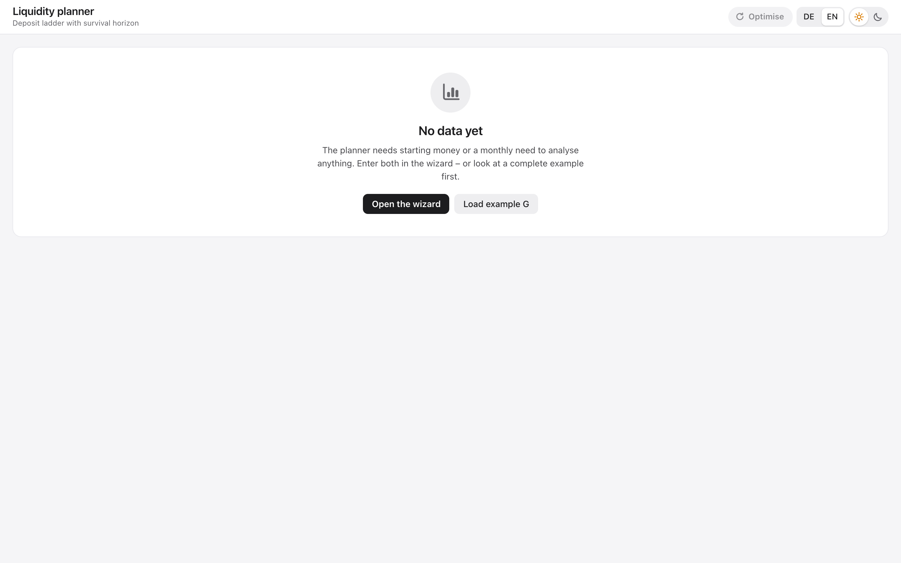
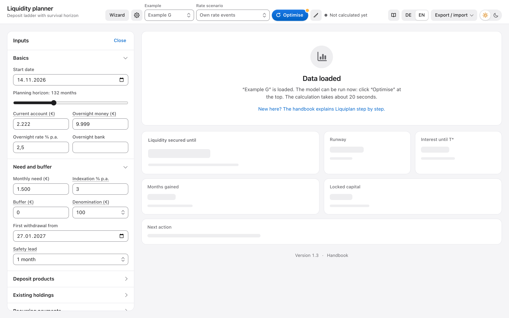
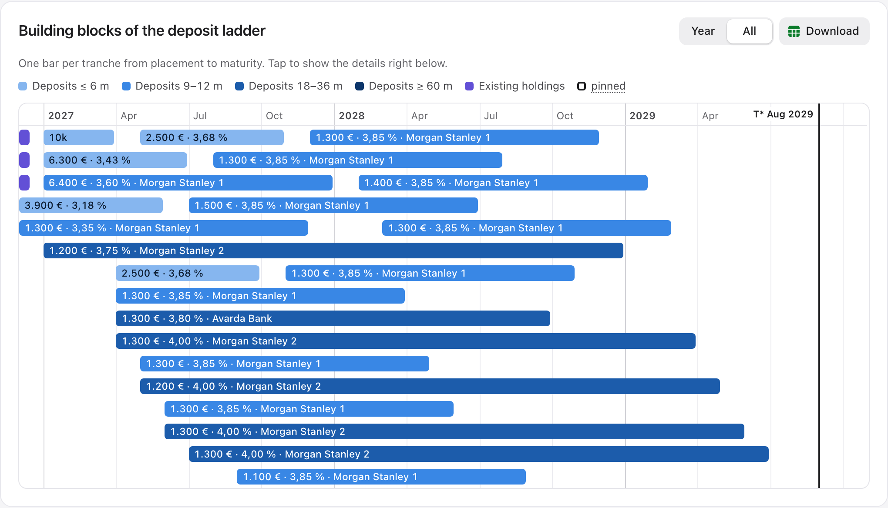
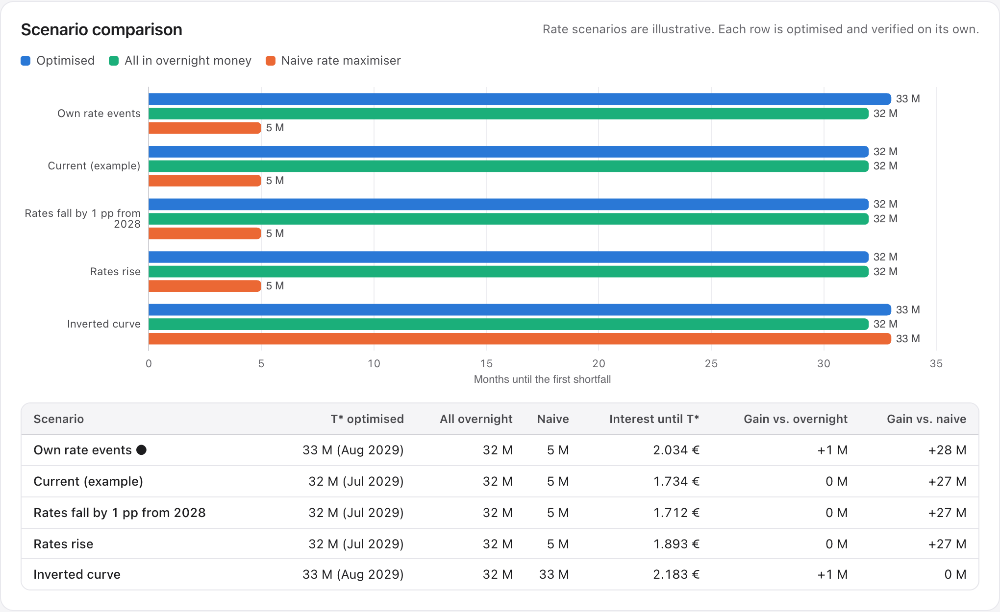
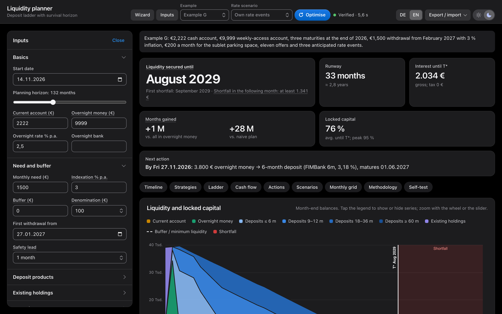
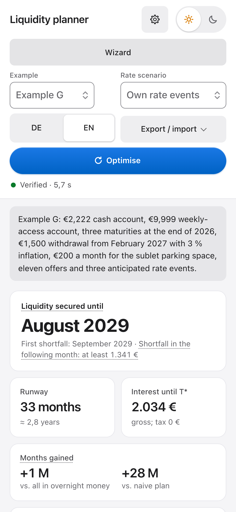
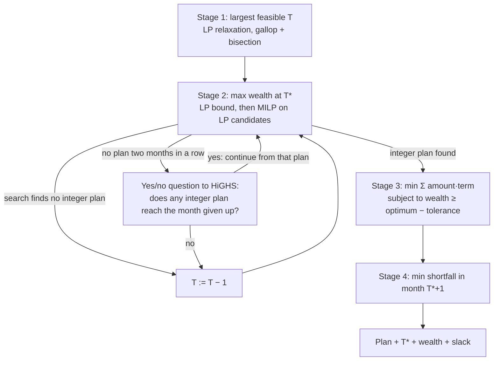
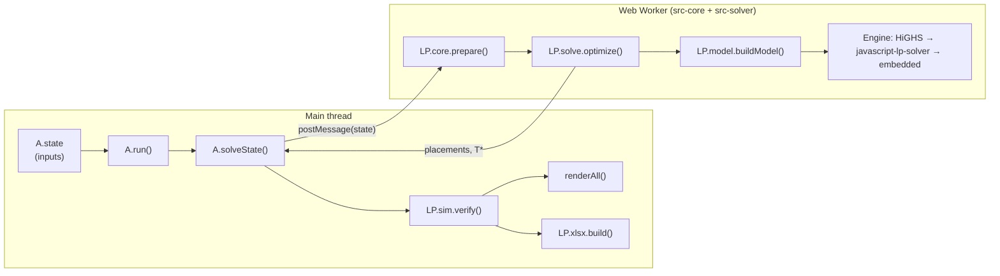

# Liquiplan: a deposit ladder planner

**Liquiditätsplaner – Festgeld-Leiter mit Überlebenshorizont** (German UI by default, English at the click of a button)

A single-file web app that answers one question: **how long will my money safely last, and which fixed-term deposits should I buy, and when, to make it last as long as possible?**

**[▶ Open the app](https://julianhilgemann.github.io/liquiplan-app/)** · nothing to install, no account, everything runs in your browser.


> **Not financial advice.** Liquiplan is a hobby project. Its results are model calculations with simplified assumptions and illustrative rates. Read the [disclaimer](#disclaimer) before relying on anything it shows.

## Contents

- [What it does](#what-it-does)
- [Using the app](#using-the-app)
- [Glossary of German terms](#glossary-of-german-terms)
- [How the optimisation works](#how-the-optimisation-works)
- [Code guide](#code-guide)
- [Function reference](#function-reference)
- [State format](#state-format)
- [Dependencies and deployment](#dependencies-and-deployment)
- [License](#license)
- [Disclaimer](#disclaimer)

---

## What it does

You describe your situation:

- **liquid money**: a current account (*Girokonto*) and an overnight/weekly-access account (*Tagesgeld*) with its rate,
- a **monthly need** that starts on a given date and rises yearly with inflation,
- other **recurring cash flows** (rent income, pension, insurance, …) and **one-off events** (a new roof, a car, a maturing life insurance),
- fixed-term deposits you **already hold**, and
- a list of **deposit offers** (term, rate, bank, minimum and maximum amount, interest convention).

The app builds a **deposit ladder** (*Festgeld-Leiter*): a schedule of placements whose maturities arrive just in time to pay the monthly need, while everything that is not needed soon earns more than overnight money. It optimises **lexicographically**, one goal strictly after the other:

1. **Maximise the survival horizon T\***: the last month up to which every month is covered without liquidity falling below the buffer.
2. **Maximise wealth at T\*** (liquidity plus open deposits including accrued interest) without giving up a single month of T\*.
3. **Prefer shorter terms** among plans with the same wealth, which keeps money flexible.
4. **Report the shortfall** in month T\*+1, so you know how much is missing for one more month.

Interest is a secondary goal by construction: it can never shorten T\*. There is no weighted sum of goals and no greedy heuristic doing the optimising. Every plan is re-computed by an independent simulator before it is shown.

| Section | What you see |
|---|---|
| **KPIs** | T\*, runway in months, months gained against two baselines, interest until T\*, share of locked capital, the next action to take |
| **Timeline** | Month-end balances as stacked areas: current account, overnight money, deposits by term bucket, existing holdings, buffer line, shortfall zone |
| **Strategies** | Optimised plan vs. "everything in overnight money" vs. a naive rate chaser, as available liquidity or total wealth |
| **Ladder** | One bar per tranche from placement to maturity, per year or for the whole horizon; tap a bar for details |
| **Cash flow** | Waterfall per year or month: opening balance, income, need, other expenses, placements, deposit repayments, overnight interest, tax, closing balance |
| **Actions** | A dated to-do list: order deadlines, value dates, maturities, and the monthly transfer to the current account |
| **Scenarios** | The whole optimisation re-run and re-verified under each interest-rate scenario |
| **Monthly grid** | Month-by-month table. Extra need, extra income and a minimum liquidity can be overridden for single months |
| **Methodology / Self-test** | The model explained inside the app, and a button that tests solver, simulator and Excel export against each other |

<table>
<tr>
<td width="50%"><br><sub>Start: a blank slate with two ways in</sub></td>
<td width="50%"><br><sub>Data loaded: Optimise is now active</sub></td>
</tr>
<tr>
<td width="50%"><br><sub>Six-chapter setup wizard</sub></td>
<td width="50%"><br><sub>Ladder: one bar per tranche</sub></td>
</tr>
<tr>
<td><br><sub>What to do, and when</sub></td>
<td><br><sub>Optimised vs. two baselines</sub></td>
</tr>
<tr>
<td><br><sub>Cash-flow waterfall per year or month</sub></td>
<td><br><sub>Every rate scenario optimised separately</sub></td>
</tr>
<tr>
<td><br><sub>Dark theme</sub></td>
<td align="center"><br><sub>Phone layout</sub></td>
</tr>
</table>

## Using the app

- **Online**: open the [GitHub Pages site](https://julianhilgemann.github.io/liquiplan-app/).
- **Your own copy**: save [the published page](https://julianhilgemann.github.io/liquiplan-app/Liquiditaetsplaner_20261114.html), or build it from this repository with `node build.mjs` (see the [code guide](#code-guide)), and open the file in a browser. It is one HTML file and needs no server. The page loads its charting, solver and Excel libraries from jsDelivr. If the solver libraries cannot load, a solver built into the page takes over.
- **First visit**: the app opens on a blank slate with two choices, *Open the wizard* or *Load example G*. **Optimise** stays greyed out until there is data. The setup wizard has six chapters, of which only the first two are required: starting liquidity and withdrawals, the economic baseline, expected central-bank rate steps, ongoing deposits, other recurring payments and new deposit offers. A chapter menu (a list on phones) jumps between them, and **Analysis** in the toolbar leads back. Once there is data, the gear button (*Inputs*) shows the same data as a side panel with a few extra settings (buffer, safety lead, denomination, tax, deposit-guarantee cap, pinned tranches).
- **Examples**: *Example G* (the reference case from the original specification), *Retirement with rental income* (20 years, pension from 2028, large one-off repairs, tax on) and *Rate trap* (example G plus a tempting 10-year deposit at 5.9 % that a naive rate chaser falls for).
- **Rate scenarios**: own central-bank steps, current rates held constant, −1 pp from 2028, rising rates (+0.5 pp a year up to +1.5 pp), inverted curve.
- **Calculation is manual**: nothing is computed until you press **Optimise**, not even when the page opens or an example is loaded. A card then confirms that the data is loaded and points to the button. After an input change the old results are greyed out until the next run. A progress dialog then ticks off each optimisation stage; *Cancel* stops the run and keeps the previous results on screen.
- **Numbers**: every number field accepts a decimal comma or a decimal point, whatever language the browser is set to (`3,12` and `3.12` are the same rate). In amounts, `10.000` and `10,000` both mean ten thousand. The field echoes back what it understood, and text that is not a number is flagged and ignored instead of being read as 0.
- **Export / import**: HTML with your inputs embedded, an Excel workbook with live formulas, the full state as JSON, and the rate table as JSON (for quick updates of offers).

**Where your data lives.** Inputs are stored only in your browser's `localStorage`. Nothing is sent to a server; the only network requests fetch the libraries. The published file itself contains no data and opens on the blank slate. *Download HTML* writes a copy of the app with your current inputs embedded, so treat that file like a private document.

## Glossary of German terms

The code and UI use German finance terms. The English UI translates them; here they are side by side.

| German | English | Meaning in the app |
|---|---|---|
| Girokonto | current account | 0 % interest; holds only next month's need |
| Tagesgeld | overnight money | variable rate, available daily; transfers arrive T+1 |
| Festgeld | fixed-term deposit | locked until maturity, no early withdrawal |
| Festgeld-Leiter | deposit ladder | deposits with staggered maturities |
| Überlebenshorizont T\* | survival horizon T\* | last month up to which every month is covered |
| Sockel / Puffer | buffer | minimum liquidity that is never touched |
| Sicherheitsvorlauf | safety lead | maturities count as available only 0, 1 or 3 months later |
| Stückelung | denomination | tranches are placed in whole steps of this amount (e.g. €100) |
| Mindestanlage | minimum amount | a tranche is either 0 or at least this amount |
| Zinskonvention | interest convention | *einfach* (all interest at maturity), *jährlich* (paid out yearly), *thesaurierend* (compounded yearly) |
| Abgeltungsteuer | flat-rate capital gains tax | 25 % + 5.5 % solidarity surcharge (+ church tax), settled each December |
| Sparerpauschbetrag | saver's allowance | yearly tax-free interest (€1,000 single, €2,000 joint) |
| Einlagensicherung | deposit guarantee | optional cap of open deposits per bank (statutory: €100,000) |
| Bankarbeitstag | business day | Mon–Fri without German nationwide holidays, 24 Dec and 31 Dec |
| Fixierte Tranche | pinned tranche | a placement you fix by hand; the optimiser takes it as given |
| Schlupf | slack | the amount missing at least in the first uncovered month |

## How the optimisation works

This section follows the data from your inputs to the plan on screen. Each heading names the function that does the work; the links jump to the line in the HTML file.

### 1. Inputs become a monthly timeline: [`prepare()`](src/core/core.js#L74)

Everything runs on a **monthly grid** `t = 0 … H−1`. Month 0 is the first month that starts on or after the start date. `prepare(state)` turns the input state into a plain problem object `P`:

- `P.need[t]`: the monthly need, starting with the first 1st of a month on or after *first withdrawal*, raised by the inflation rate in yearly steps.
- `P.inflow[t]` and `P.outflow[t]`: recurring streams (monthly, quarterly, yearly, each with its own indexation), one-off events and the per-month overrides from the monthly grid.
- `P.floor[t]`: the buffer, or a per-month minimum liquidity from the grid.
- `P.rTG[t]` and `P.products[k].rate[t]`: the overnight rate and each product's rate **for a placement made in month t**, from [`scenarioRate()`](src/core/core.js#L59). User-defined central-bank steps shift all rates from the first month that begins on or after the step's date.
- `P.tax.rate`: the effective flat-rate tax, `kest = 0.25 / (1 + 0.25·k)` and `rate = kest · (1 + 0.055 + k)` for a church-tax rate `k`.
- `P.products[k].minU / maxU`: minimum and maximum amount in denomination units.
- `P.existing` (holdings with their maturity month) and `P.pins` (fixed placements).

`prepare` is the only code shared between the solver and the simulator. It contains **no** payout, tax or balance logic, so the two sides can check each other.

### 2. The model: [`buildModel(P, T, opt)`](src/solver/model.js#L48)

For a candidate horizon `T` the app builds a mixed-integer linear programme (MILP) with these columns:

```text
u[t]   ≥ floor[t]     liquidity at month end minus maturities still inside the safety lead
n[τ,k] ∈ {0,1,2,…}    denomination units placed in product k at the start of month τ
y[τ,k] ∈ {0,1}        1 if that placement is used (only needed for minimum amounts)
q[y]   ≥ 0            taxable interest of calendar year y above the allowance
z      ≥ 0            slack of month T (only for stage 4)
```

**Balance row for every month** (`b<t>`, see [the balance rows](src/solver/model.js#L85)):

```text
s[t] = s[t−1]·(1 + rTG[t]/12) + net[t] + payouts[t] − placements[t] − tax[t]
```

Liquidity `s` is not a column. The model works with `u[t] = s[t] − R[t]`, where `R[t]` is the cash from maturities of the last λ months (λ = safety lead). The "never below the buffer, and don't count on money that is only just maturing" constraint then becomes a plain **lower bound** `u[t] ≥ floor[t]` instead of an extra row. The coefficients that `R` adds to later months are folded into each placement's column.

**Payouts per €1** come from [`unitFlows(conv, r, L)`](src/solver/model.js#L16) for a rate `r` and term `L` months (with `n` full years and `f` remaining months):

```text
simple    1 + r·L/12 at maturity
annual    r to overnight money after each full year, then 1 + r·f/12 at maturity
compound  (1 + r)^n · (1 + r·f/12) at maturity, taxed yearly on the accrued interest
```

[`unitAccrued()`](src/solver/model.js#L31) values a deposit that is still open at `T` (principal plus accrued interest), which matters for the wealth objective.

**Tax is linear.** For every December inside the horizon there is a row `q[y] ≥ interest[y] − allowance` and the balance row of that December pays `rate · q[y]`. `q` only has a lower bound. Paying more tax never helps any constraint or objective, so the optimum always settles at `q = max(0, interest − allowance)`. That is an exact linearisation of the kink.

**Minimum amounts are semi-integer**: a placement is either 0 or between `minU` and `maxU` units. External solvers get the classic binary formulation (`n ≥ minU·y`, `n ≤ maxU·y`). The embedded branch-and-bound handles it natively (`nativeSemi`) by branching on `n = 0` vs. `n ≥ minU`.

**The deposit-guarantee cap** (optional) limits the open principal per bank. These rows are added **lazily**: solve, check with [`capViolations()`](src/solver/model.js#L241), add only the violated `bank|month` rows and solve again (up to 25 rounds). Exposure can only rise in a month where a tranche starts, so only those months are ever checked.

**Options** of `buildModel` decide which candidate placements become columns:

- `allowBeyond: false` drops deposits that would mature (plus lead) after `T`. For the feasibility test this is lossless: such a deposit only takes cash out before `T`.
- `cand` restricts the columns to a candidate set proposed by an LP (see stage 2).
- `grid` thins out placement months for very large models in the embedded solver.
- `obj` selects the objective: `none` (feasibility), `wealth`, `term` or `slack`. `wealthMin` adds a lower bound on wealth (for stage 3).

### 3. Four stages: [`optimize()`](src/solver/optimize.js#L22)



The progress dialog shows these stages live while the app optimises, followed by the independent verification and the scenario comparison:


**Stage 1: maximise T\*** ([code](src/solver/optimize.js#L46)). Feasibility is **monotone** in `T`: if months 0…T can all be covered, so can 0…T−1. The app therefore searches for the largest feasible `T` with LP relaxations (no integrality, fast). It starts from a known-feasible month (the simulator's horizon without any new placements, `loHint`), **gallops** upwards with doubling steps until the first infeasible month, then **bisects**. That is `O(log H)` LPs.

**Stage 2: maximise wealth at T\*** ([LP bound](src/solver/optimize.js#L60), [MILP](src/solver/optimize.js#L74)). With `T` fixed, an LP maximises `s[T] + Σ open deposits incl. accrued interest`. Its value is an upper bound. The integer problem (denominations, minimum amounts) is then solved only on a **candidate set**: every (month, product) pair that the LP solutions used, plus all products in "event months" (month 0, existing maturities and the safety-lead months after them, and months with one-off income). This keeps the MILP small enough for a browser.

**When the search finds no integer plan** ([code](src/solver/optimize.js#L81)). Sometimes the LP reaches `T` but no integer plan does, for example because €100 steps or a €1,000 minimum don't fit. And sometimes a plan exists but the search does not find it within its budget. The first month without a plan is given up (`T := T − 1`): it usually is out of reach, and proving that can take long. If the search then fails again one month lower, it is the search that is failing, not the months. HiGHS is then asked a plain yes/no question, first for the month that was given up and then for the current one: is there *any* integer plan up to this month? Without an objective the first plan HiGHS finds is optimal, so it stops there and returns it. A "yes" takes the month back, and stage 2 continues from that plan. At most two questions are asked per run. Without HiGHS the embedded search instead minimises the slack of month `T` on a widened candidate set (±1 month around every candidate). This is the only way T\* can end up below the LP value. The KPI then shows the LP bound and says whether the month was not reached or a plan was merely not found within the search budget.

**Stage 3: prefer short terms** ([LP](src/solver/optimize.js#L68), [MILP](src/solver/optimize.js#L122)). Among plans whose wealth is within a tolerance of the stage-2 optimum (€0.05 or 10⁻⁶ relative, whichever is larger), minimise `Σ amount × term`. Ties are common (several ladders reach the same wealth) and the shorter ones keep more options open.

**Stage 4: report the shortfall** ([code](src/solver/optimize.js#L140)). For month `T+1` minimise the slack `z` in `u[T+1] + z ≥ floor[T+1]`. LP and MILP give the amount that is at least missing to survive one more month.

Why lexicographic and not a weighted objective? A weighted sum needs a penalty weight that trades months of safety against euros of interest, and any finite weight can be "bought off" by a high enough rate. Solving goals strictly in order makes "interest never shortens T\*" a guarantee, not a tuning result.

### 4. Solvers and how far each answer is trusted: [`Engine`](src/solver/engine.js#L16)

The optimisation runs in a **Web Worker**, built at runtime from the page's own `src-core` and `src-solver` script text via a Blob URL ([`S.start`](src/app/ui/solver-client.js#L11)). No separate worker file is needed, so the single HTML file works anywhere. On start the worker tries a chain of backends ([worker glue](src/solver/workerglue.js#L1)):

1. **[HiGHS](https://highs.dev)** compiled to WebAssembly ([`HighsBackend`](src/solver/backends.js#L19)). It receives the model as CPLEX LP text from [`toLPString()`](src/solver/model.js#L265). LPs are retried with presolve off and then with the interior-point method if the first attempt fails.
2. **javascript-lp-solver** ([`JsLpBackend`](src/solver/backends.js#L53)), used for LPs only.
3. **The embedded solver** ([`EmbeddedBackend`](src/solver/backends.js#L96)): a dense bounded-variable simplex plus branch-and-bound, written for this app. It is always present.

**Same inputs, same plan, on every machine.** No limit in the optimisation is measured in real time, so a slower machine does exactly the same work and only takes longer:

- **LPs** have one exact answer. They go to the first backend of the chain.
- **Integer problems with an objective** go to the embedded branch-and-bound only. Its budget runs on a **work clock** ([`now()`](src/solver/simplex.js#L13)) that advances with the arithmetic done (tableau operations), not with seconds. HiGHS is not used for these: it returns its best plan so far only when it stops on a time limit, never on a node limit.
- **Yes/no questions** to HiGHS run on a **tick clock** ([`onTickClock`](src/solver/backends.js#L10)): while HiGHS answers, `performance.now()` and `Date.now()` return a counter that goes up by one per call, so its time limit is a fixed number of clock reads.
- **Powers** such as `(1 + r)^n` are computed by repeated multiplication ([`powi`](src/core/core.js#L72)), because `Math.pow` may differ in the last bit between browsers, which is enough to send the search down another branch.

The plan still depends on *which* LP solver loaded: HiGHS and the embedded simplex can return different optimal corners, and those decide the candidate set. When the fallback did the work, the result tile says so.

HiGHS and javascript-lp-solver must each solve a tiny test MILP correctly on load (optimum 7) before they are used. Answers are trusted only as far as they were checked:

- **Every MILP answer is "polished"** ([`polish()`](src/solver/simplex.js#L303)): the integer columns are rounded and fixed, and the continuous rest (liquidity, tax) is re-solved exactly. Results that don't survive this are discarded.
- **[`Engine.milp`](src/solver/engine.js#L51)** runs the embedded branch-and-bound on the work clock. A plan known from elsewhere (the answer to a yes/no question) can be passed in as a starting point; the search can then only improve on it.
- **[`Engine.lp`](src/solver/engine.js#L27)**: an optimum from javascript-lp-solver is accepted only if the embedded simplex reaches the same objective value, and an "infeasible" from it is never trusted. After two rejected answers the backend is dropped for the session. HiGHS is restarted after a crash, at most twice, before it is dropped.
- **Watchdog**: before each call the worker posts a heartbeat with a time budget ([`S.arm`](src/app/ui/solver-client.js#L30)). If the budget runs out, the main thread kills the worker, marks that backend as skipped (javascript-lp-solver for a week, via `localStorage`), restarts and re-sends the job. This watchdog is the only real-time limit left, and its budgets are generous so that a slow device is not mistaken for a hang. If even the embedded solver hangs, or Workers are unavailable, the embedded solver runs on the main thread ([`S.toMain`](src/app/ui/solver-client.js#L24)).

**Inside the embedded solver** ([`Dense`](src/solver/simplex.js#L15), [`solveMILP`](src/solver/simplex.js#L328)):

- A **bounded-variable tableau simplex**: two-phase [primal](src/solver/simplex.js#L143) with artificial variables, and [dual simplex](src/solver/simplex.js#L198) re-optimisation after bound changes, so every B&B node is warm-started from its parent's basis. A periodic [`refactor()`](src/solver/simplex.js#L65) rebuilds the tableau from the original rows to remove floating-point drift.
- **Branch-and-bound** as a [depth-first search](src/solver/simplex.js#L421) with bound pruning and absolute/relative gap tolerances. A root heuristic (round everything down, fix it, re-solve) provides an early incumbent. The search cycles through three branching rules in slices of its work budget: chronological with semi-integer violations first and the down branch first (50 % of the budget), largest value (to 75 %), most fractional with the nearest branch first (to 100 %). It stops as soon as one rule has searched the tree completely.
- **Semi-integer branching**: a column with `0 < n < min` branches into `n = 0` and `n ≥ min`, with no binary helper variable.

### 5. Independent verification: [`LP.sim.run()`](src/app/sim.js#L10) and [`verify()`](src/app/sim.js#L113)

The simulator deliberately **shares no code with the model**. It walks through the calendar, keeps the state of every tranche (principal, age, interest paid), and judges each month in this order:

1. overnight interest on last month's closing liquidity,
2. tranche events: maturities (existing holdings, new deposits by convention) and yearly anniversaries (paid out or compounded),
3. the month's inflows and outflows,
4. new placements from the plan (or from a baseline policy),
5. tax in December on the year's interest above the allowance,
6. month-end records: the current account holds next month's outflow, the rest is overnight money,
7. the month is **covered** if liquidity minus maturities still inside the safety lead is at least the floor (half-cent tolerance). T\* is the last month of the unbroken run of covered months.

`verify()` checks every placement (denomination, minimum, maximum, rate > 0, inside the horizon), checks the bank cap, and checks that the simulated T\* is at least the solver's T\*. **A plan that fails is not shown**; an error explains why.

The two **baselines** are only simulated: [`allTagesgeld()`](src/app/sim.js#L94) keeps everything liquid, and [`naive()`](src/app/sim.js#L96) buys the highest-rate product each month (if it beats overnight money) with all cash above `floor + 3 × next month's need` (the reserve multiple is adjustable).

### 6. From months to calendar dates: [`trancheDates()`](src/app/views/ladder.js#L8)

The model thinks in months; the action list needs real dates. A placement for month *t* has to be **ordered by the penultimate business day of the previous month** ([`penultimateBusinessDay()`](src/core/core.js#L51)), is **valued on the first business day** of month *t*, and matures on the next business day after `term` months. Business days exclude weekends, German nationwide holidays ([`holidays()`](src/core/core.js#L34), with Easter from the anonymous Gregorian algorithm) and 24/31 December. The standing transfer of next month's need from overnight money to the current account follows the same T+1 rule. [`buildActions()`](src/app/views/actions.js#L7) turns all of this into the grouped to-do table.

### 7. Excel export: [`LP.xlsx.build()`](src/app/xlsx.js#L70)

The workbook is written with ExcelJS and post-processed with JSZip. It has nine sheets: `Cover`, `Inputs`, `CashFlows`, `Ladder`, `Liquidity`, `Gap`, `Scenarios`, `Charts`, `Solver`.

- Derived cells are **real formulas** on named input cells (the blue cells, mostly on `Inputs`), so you can change an amount or a rate in Excel and the sheets follow.
- [`mirror()`](src/app/xlsx.js#L24) recomputes every formula column in plain JS, row by row, the way Excel will. Those values are stored as cached results, so the file shows correct numbers even before Excel recalculates. A third independent implementation of the bookkeeping, compared in the self-test.
- Native **DrawingML charts** are injected into the zip.
- The `Solver` sheet comes with **pre-filled Excel Solver settings** (`solver_*` defined names) to re-run stage 2 (maximise wealth at a fixed T\*) inside Excel, with step-by-step instructions.
- [`sensitivity()`](src/app/xlsx.js#L61) re-simulates the plan under parallel rate shifts.

### 8. Self-test: [`A.selftest()`](src/app/selftest.js#L7)

The **Self-test** button runs, for every example: the plan is verified and the simulated T\* ≥ the solver's T\*; the optimised T\* ≥ the all-overnight baseline. Then three property tests: the rate trap never ends worse than the plain case; **adding a product never shortens T\***; **adding an inflow never shortens T\***. Finally the Excel export is built, re-opened with ExcelJS, and its formula values are compared with the web simulation (≤ 1 cent per month, same first shortfall).

### Simplifications

- Current account and overnight money are pooled as one liquidity variable earning the overnight rate.
- Tax is settled once a year in December; the allowance applies per calendar year.
- The safety lead applies to all maturities, including existing holdings and reinvestments.
- Indexation happens in yearly steps from the start date or the start of a payment.
- The bank cap refers to deposit principal.
- The MILP works on an LP-proposed candidate set; the LP provides the upper bound.
- Processing days and the weekly access date from the wizard are stored but not yet modelled to the day; the safety lead in whole months stands in for them.

---

## Code guide

### Many source files, one file to ship

The app ships as a single HTML file, and the code relies on that: the solver worker is started from the text of two of the page's own script blocks, and *Download HTML* ([`A.buildHtml()`](src/app/export.js#L30)) saves the page by writing those blocks back out together with the current state. The sources are kept apart in [`src/`](src/), and [`build.mjs`](build.mjs) joins them into `dist/index.html`:

```sh
node build.mjs           # build once, then open dist/index.html in a browser
node build.mjs --watch   # rebuild whenever a file in src/ changes
```

The build needs Node.js and nothing else. It does not bundle, transpile or minify. [`src/index.html`](src/index.html) is the page with an `<!-- @include … -->` line where each file goes, and the build pastes the files in, in that order. `dist/` is not committed; the Pages workflow builds its own.

| Source | Becomes | Runs in | Contains |
|---|---|---|---|
| [`src/index.html`](src/index.html) | the page | – | the template: the head, the order of all includes, and [`<script id="src-theme">`](src/index.html#L10), which applies the saved light/dark choice before the first paint |
| [`src/styles/`](src/styles/) | [`<style id="css">`](src/styles/tokens.css#L1) | – | the design system and the styles of each part of the page (see [Styles](#styles)) |
| [`src/markup/`](src/markup/) | [`<div id="app">`](src/markup/toolbar.html#L1) | – | the static page skeleton: toolbar, wizard, the workspace with one file per result section, overlays |
| [`src/core/`](src/core/) | [`<script id="src-core">`](src/core/core.js#L1) | main thread **and** worker | `core.js` (dates, calendar, timeline), `presets.js` |
| [`src/solver/`](src/solver/) | [`<script id="src-solver">`](src/solver/model.js#L1) | worker | `model.js`, `simplex.js`, `backends.js`, `engine.js`, `optimize.js`, `workerglue.js` |
| [`src/app/`](src/app/) | [`<script id="src-app">`](src/app/sim.js#L1) | main thread | `sim.js`, `i18n/`, `ui/`, `views/`, `xlsx.js`, `wizard.js`, `export.js`, `selftest.js`, `main.js` |

The page also carries [`<script id="embedded-state">`](src/index.html#L66): the inputs a downloaded copy was saved with, empty in the published app.

The three script blocks are a functional split: the worker is assembled from the text of `src-core` + `src-solver`, so a file's folder decides where it runs.

There are no ES modules. Every `.js` file is an IIFE that hangs its API on one global namespace, `LP` (`LP.core`, `LP.model`, `LP.solve`, `LP.sim`, `LP.app`, …), so the order of the includes is the load order. A file starts with what it takes from that namespace and ends with what it adds to it. `A` is short for `LP.app` throughout; the result views share their helpers through `LP.views`.

### Styles

[`src/styles/`](src/styles/) is included in cascade order. The first three files are the design system; each of the others styles one part of the page.

| Files | Contain |
|---|---|
| [`tokens.css`](src/styles/tokens.css) | The design tokens as CSS custom properties: colours of the light and the dark theme (system setting or the manual switch), chart colours, fonts, radii, and stronger separators for *Increase Contrast*. Charts read their colours from here when they are drawn, so they follow the theme |
| [`base.css`](src/styles/base.css) | Reset, type scale, focus ring, utility classes |
| [`controls.css`](src/styles/controls.css) | Fields, buttons, segmented control, theme switch |
| `toolbar.css`, `shell.css`, `inputs.css` | Top bar with solver status and export menu, the two-column layout with the inputs drawer, input groups and entry cards |
| `cards.css`, `kpis.css`, `notes.css`, `charts.css`, `tables.css` | Building blocks of the results: cards, KPI tiles, pills and notes and the section navigation, chart sizes and legends, tables |
| `ladder.css`, `ladder-years.css`, `actions.css`, `waterfall.css`, `strategies.css` | One result section each |
| `methodology.css`, `dialogs.css`, `empty-state.css`, `progress.css`, `wizard.css`, `stale.css` | Methodology text and glossary tooltip, toasts and the JSON dialog, the blank slate, the progress dialog, the setup wizard, the "inputs changed" bar |
| [`responsive.css`](src/styles/responsive.css) | Phones, touch targets, *Reduce Motion*. Last, so that it overrides the rest |

### How the parts work together



### Follow one run

If you want to read the code end to end, this is the order in which it executes when you press **Optimise**:

1. [`A.run()`](src/app/views/pipeline.js#L62): cancels older runs, shows progress, calls `solveState` for the chosen scenario, then for every other scenario in the background.
2. [`A.solveState()`](src/app/views/pipeline.js#L16): `prepare` on the main thread, simulates the baselines and the no-placement horizon (`loHint`), sends the job to the worker and verifies the result.
3. [`S.solve()`](src/app/ui/solver-client.js#L61) → worker message `solve` → [`prepare()`](src/core/core.js#L74) → [`optimize()`](src/solver/optimize.js#L22).
4. `optimize()` calls [`buildModel()`](src/solver/model.js#L48) for each stage and hands it to [`Engine.lp`](src/solver/engine.js#L27) / [`Engine.milp`](src/solver/engine.js#L51).
5. The result returns to `solveState`, goes through [`verify()`](src/app/sim.js#L113), and lands in `A.view`.
6. [`renderAll()`](src/app/views/render.js#L38) draws KPIs, charts, ladder, waterfall, actions, scenarios and grid from `A.view`.

## Function reference

### `core/core.js` – shared input preparation (`LP.core`)

| Function | Purpose |
|---|---|
| [`parseISO`, `iso`, `ymIdx`, `ymOf`, `addDays`, …](src/core/core.js#L9) | Calendar arithmetic on plain `{y, m, d}` objects, no time zones |
| [`easter`](src/core/core.js#L25) / [`holidays`](src/core/core.js#L34) | Easter date (anonymous Gregorian algorithm) and German nationwide bank holidays incl. 24/31 Dec |
| [`isBusinessDay`, `nextBusinessDay`, `prevBusinessDay`](src/core/core.js#L43) | Business-day logic for order, value and maturity dates |
| [`penultimateBusinessDay`](src/core/core.js#L51) | Order deadline for placements and the monthly transfer |
| [`scenariosFor`](src/core/core.js#L58) / [`scenarioRate`](src/core/core.js#L59) | Available rate scenarios and the rate of a product in month *t* under a scenario |
| [`prepare`](src/core/core.js#L74) | Input state → problem object `P` (timeline, rates, products, holdings, pins). `over` overrides horizon, scenario or a parallel rate shift |

### `core/presets.js` – examples and the spec JSON reader (`LP.presets`, `LP.wizardJson`)

| Function | Purpose |
|---|---|
| [`products`](src/core/presets.js#L6) / [`base`](src/core/presets.js#L21) | Generic product list and default state |
| [`isWizardJson`](src/core/presets.js#L38) / [`fromWizardJson`](src/core/presets.js#L39) | Detect and convert the `deposit-savings-planner` wizard JSON of the original specification into app state |
| [`presets`](src/core/presets.js#L88) | The three examples: `g`, `ruhestand`, `zinsfalle` |

### `solver/model.js` – the MILP (`LP.model`)

| Function | Purpose |
|---|---|
| [`unitFlows`](src/solver/model.js#L16) | Cash and taxable-interest events of €1 in a product (simple, annual, compound) |
| [`unitAccrued`](src/solver/model.js#L31) | Value of €1 after *e* months, for deposits still open at T |
| [`Model`](src/solver/model.js#L38) | Minimal sparse model container: `col()`, `row()`, `add()` |
| [`buildModel`](src/solver/model.js#L48) | Builds the model for horizon T: [fixed tranches](src/solver/model.js#L55), [balance rows](src/solver/model.js#L85), tax rows, [candidate placements](src/solver/model.js#L111), wealth objective, [bank-cap rows](src/solver/model.js#L185) |
| [`wealthOf`](src/solver/model.js#L209) / [`objOf`](src/solver/model.js#L214) | Evaluate wealth at T and the objective for a solution vector |
| [`checkSolution`](src/solver/model.js#L217) | Generic feasibility check of a vector (bounds, rows, integrality, semi-integer) |
| [`capViolations`](src/solver/model.js#L241) | Bank/month pairs where the cap is exceeded (for lazy rows) |
| [`placementsOf`](src/solver/model.js#L254) | Solution vector → list of `{t, k, amount}` |
| [`toLPString`](src/solver/model.js#L265) | Model → CPLEX LP format for HiGHS |

### `solver/simplex.js` – the embedded solver (`LP.simplex`)

| Function | Purpose |
|---|---|
| [`Dense`](src/solver/simplex.js#L15) | Dense tableau with bounded variables, slacks and artificials |
| [`Dense.prototype.primal`](src/solver/simplex.js#L143) | Primal simplex (phase 1 and 2) |
| [`Dense.prototype.dual`](src/solver/simplex.js#L198) | Dual simplex for re-optimisation after bound changes |
| [`Dense.prototype.refactor`](src/solver/simplex.js#L65) | Rebuild the tableau from the original rows (removes drift) |
| [`solveLP`](src/solver/simplex.js#L294) | One LP solve |
| [`now`](src/solver/simplex.js#L13) | The work clock: every limit of the embedded solver is measured on it |
| [`polish`](src/solver/simplex.js#L303) | Fix rounded integers, re-solve the continuous rest exactly |
| [`solveMILP`](src/solver/simplex.js#L328) | Branch-and-bound: root heuristic, [DFS](src/solver/simplex.js#L421), branching rules, gap control |

### `solver/backends.js`, `engine.js`, `optimize.js` – backends and the lexicographic optimisation (`LP.solve`)

The backends behind one interface, the engine that decides which backend answers which question, and the optimisation itself.

| Function | Purpose |
|---|---|
| [`HighsBackend`](src/solver/backends.js#L19) | HiGHS (WASM): self-test, LP retries, yes/no questions on the tick clock |
| [`JsLpBackend`](src/solver/backends.js#L53) | javascript-lp-solver: model conversion, LP with cross-check |
| [`EmbeddedBackend`](src/solver/backends.js#L96) | Wraps `LP.simplex` with the same interface |
| [`Engine`](src/solver/engine.js#L16) | Picks the backend, cross-checks, falls back, demotes unreliable backends, keeps statistics |
| [`supportKeys`](src/solver/optimize.js#L6) / [`eventMonths`](src/solver/optimize.js#L9) / [`addNeighbours`](src/solver/optimize.js#L16) | Build the MILP candidate sets from LP solutions |
| [`optimize`](src/solver/optimize.js#L22) | The four stages, knife-edge handling and lazy cap rows |

### `solver/workerglue.js` – worker protocol

| Function | Purpose |
|---|---|
| [`init`](src/solver/workerglue.js#L12) | Loads HiGHS / javascript-lp-solver from the CDN (with timeouts), builds the `Engine`, posts `ready` |
| [`solve`](src/solver/workerglue.js#L42) | `prepare` → `optimize`, posts `progress`, `beat`, `result` or `error` |

### `app/sim.js` – independent simulator (`LP.sim`)

| Function | Purpose |
|---|---|
| [`run`](src/app/sim.js#L10) | Month-by-month simulation of a plan or a policy; returns balances, tranches, T\*, interest, tax, locked share |
| [`withPins`](src/app/sim.js#L87) | Adds pinned tranches to a plan |
| [`allTagesgeld`](src/app/sim.js#L94) / [`naive`](src/app/sim.js#L96) | The two baselines |
| [`verify`](src/app/sim.js#L113) | Validates a solver result against the simulation |

### `app/i18n/` – texts (`LP.i18n`)

The UI strings in [German](src/app/i18n/de.js) and [English](src/app/i18n/en.js) under the same keys, the [glossary](src/app/i18n/glossary.js#L6) behind the dotted terms, and the [methodology text](src/app/i18n/methodology.js#L6) shown in the app.

### `app/ui/` – state, formatting, solver client, input drawer (`LP.app`, alias `A`)

In load order: `dom.js`, `state.js`, `format.js`, `tooltip.js`, `solver-client.js`, `drawer.js`.

| Function | Purpose |
|---|---|
| [`el`](src/app/ui/dom.js#L17) | Builds a DOM element from a tag, properties and children; used for nearly all markup the scripts create |
| [`normalize`](src/app/ui/state.js#L12) / [`loadState`](src/app/ui/state.js#L32) | Fill defaults; load from `localStorage`, else the embedded state, else a blank state ([`A.blankState`](src/app/ui/state.js#L28)) |
| [`A.save`](src/app/ui/state.js#L39) | Debounced save to `localStorage` |
| [`t`](src/app/ui/format.js#L7), [`A.eur`](src/app/ui/format.js#L15), [`A.monthLabel`](src/app/ui/format.js#L52), … | Translation and number/date formatting |
| [`S.start`](src/app/ui/solver-client.js#L11), [`S.solve`](src/app/ui/solver-client.js#L61), [`S.arm`](src/app/ui/solver-client.js#L30), [`S.onMsg`](src/app/ui/solver-client.js#L41) | Solver client: worker from Blob, job queue, watchdog, main-thread fallback |
| [`A.parseNum`](src/app/ui/format.js#L25) / [`A.numField`](src/app/ui/format.js#L62) | Read a typed number with either decimal sign; the one number field used by the drawer, the wizard and the monthly grid |
| [`A.renderSide`](src/app/ui/drawer.js#L33) | The input drawer (basics, need and buffer, products, holdings, payments, one-offs, pins, tax and cap) |

### `app/views/` – pipeline and result views

One file per result view, plus `shared.js` (what the views have in common), `render.js` (draws all of them), `progress.js` (the dialog during a run) and `pipeline.js` (the run itself).

| Function | Purpose |
|---|---|
| [`A.solveState`](src/app/views/pipeline.js#L16) | Optimise + verify one state (used by the main run, scenarios and the self-test) |
| [`A.run`](src/app/views/pipeline.js#L62) / [`A.markStale`](src/app/views/pipeline.js#L40) | Run the pipeline; mark results as out of date after an input change |
| [`renderKpis`](src/app/views/kpis.js#L7) | KPI tiles |
| [`renderMain`](src/app/views/timeline.js#L8) | Liquidity and locked-capital area chart (ECharts) |
| [`renderStrat`](src/app/views/strategies.js#L9) | Strategy comparison |
| [`renderLadder`](src/app/views/ladder.js#L30), [`trancheDates`](src/app/views/ladder.js#L8), [`trancheTotals`](src/app/views/ladder.js#L19) | Ladder (Gantt) and tranche details |
| [`renderWf`](src/app/views/waterfall.js#L18) | Cash-flow waterfall |
| [`buildActions`](src/app/views/actions.js#L7) / [`renderActions`](src/app/views/actions.js#L24) | Dated action list |
| [`renderScen`](src/app/views/scenarios.js#L7) | Scenario chart and table |
| [`renderGrid`](src/app/views/grid.js#L6) / [`setOv`](src/app/views/grid.js#L32) | Monthly grid with editable overrides |
| [`renderAll`](src/app/views/render.js#L38) | Draws every view from `A.view`, or the blank slate and the ready card when there is no result yet |
| [`chart`](src/app/views/shared.js#L19) / [`toggleLegend`](src/app/views/shared.js#L36) | One ECharts instance per chart element; legends whose entries switch a series on and off |
| [`runOpen`](src/app/views/progress.js#L64) / [`runStep`](src/app/views/progress.js#L29) | The progress dialog: opens for a run and ticks off the solver's stages |
| [`A.abortRun`](src/app/views/pipeline.js#L50) | Cancels a run; what is on screen stays |

### `app/xlsx.js` – Excel export (`LP.xlsx`)

| Function | Purpose |
|---|---|
| [`ladderRows`](src/app/xlsx.js#L14) | Tranches → rows of the `Ladder` sheet |
| [`mirror`](src/app/xlsx.js#L24) | JS re-computation of every sheet formula (cached values + self-test) |
| [`sensitivity`](src/app/xlsx.js#L61) | Plan re-simulated under parallel rate shifts |
| [`build`](src/app/xlsx.js#L70) | Writes the nine sheets, charts and Solver names |

### `app/wizard.js` – six-chapter setup (`A.wizard`)

| Function | Purpose |
|---|---|
| [`W.render`](src/app/wizard.js#L174), [`W.go`](src/app/wizard.js#L194), [`W.show`](src/app/wizard.js#L196), [`W.finish`](src/app/wizard.js#L207) | Chapter navigation; edits only mark results stale, they never start a calculation |
| [`rows`](src/app/wizard.js#L68), [`q`](src/app/wizard.js#L64), [`yesNo`](src/app/wizard.js#L59) | Repeating row editors, numbered questions and yes/no switches. "No" parks rows in `state.stash` instead of deleting them |

### `app/export.js`, `selftest.js`, `main.js` – files, self-test, start-up

| Function | Purpose |
|---|---|
| [`A.saveFile`](src/app/export.js#L11) | Download helper |
| [`A.buildHtml`](src/app/export.js#L30) | Re-assembles the page from its own blocks, with the current state embedded |
| [`A.exportXlsx`](src/app/export.js#L49) | Loads ExcelJS + JSZip on demand and builds the workbook |
| [`applyState`](src/app/main.js#L20) / [`applyRates`](src/app/main.js#L29) | JSON import of the full state (own format or the spec format) or of the rate table |
| [`A.selftest`](src/app/selftest.js#L7) | The self-test described above |
| [`wire`](src/app/main.js#L49) / [start-up](src/app/main.js#L112) | Event wiring, first render (blank slate, or the ready card for saved inputs) and a warm-up of the solver worker; the first optimisation waits for **Optimise** |

## State format

The complete input is one JSON object (*Export / import → State as JSON*). The main fields:

| Field | Meaning |
|---|---|
| `startDate`, `horizon` | Start date (ISO) and planning horizon in months (≤ 360) |
| `giro`, `tg`, `tgRate` | Current account, overnight balance (€) and overnight rate (% p.a.) |
| `need`, `needIdx`, `needStart` | Monthly need (€), yearly indexation (%), first withdrawal date |
| `buffer`, `lead`, `denom` | Buffer (€), safety lead (0, 1 or 3 months), denomination (€) |
| `rateScenario`, `rateEvents[]` | Scenario id and own central-bank steps `{date, change}` in percentage points |
| `products[]` | Offers: `{id, term, rate, bank, min, max, conv: simple / annual / compound, on}` |
| `existing[]` | Holdings: `{label, bank, amount, rate, maturity}` |
| `streams[]` | Recurring payments: `{name, amount (± €), freq: m / q / y, start, end, idx}` |
| `oneoffs[]` | One-off events: `{date, amount (± €), label}` |
| `pins[]` | Pinned tranches: `{month, productId, amount}` |
| `overrides` | Monthly grid overrides keyed by `YYYY-MM`: `{extraNeed, extraIn, minLiq}` |
| `tax`, `bankCap` | `{on, church, allowance}` and `{on, cap}` |

The importer also accepts the `deposit-savings-planner` JSON from the original specification and converts it with `fromWizardJson()`.

## Dependencies and deployment

The app has no npm dependencies. Its libraries are loaded at run time from jsDelivr, with pinned versions:

| Library | Version | Used for |
|---|---|---|
| [ECharts](https://echarts.apache.org) | 5.5.1 | all charts |
| [HiGHS](https://github.com/lovasoa/highs-js) | 1.15.4 | LP solver and yes/no questions (WebAssembly) |
| [javascript-lp-solver](https://github.com/JWally/jsLPSolver) | 0.4.24 | secondary LP solver |
| [ExcelJS](https://github.com/exceljs/exceljs) | 4.4.0 | Excel export (loaded on demand) |
| [JSZip](https://stuk.github.io/jszip/) | 3.10.1 | chart and Solver-name injection into the xlsx |

The site is published by [`.github/workflows/pages.yml`](.github/workflows/pages.yml): on every push to `main` it runs `node build.mjs` and deploys the built file to GitHub Pages as `index.html`. If the build fails, nothing is deployed and the site keeps its last version.

## License

[MIT](LICENSE). Use it, change it, share it.

## Disclaimer

**This is not financial advice.** Liquiplan is a personal project built for fun and learning. Nothing in the app, this README or the exported files is financial, investment, tax or legal advice, or a recommendation to buy any product or to use any bank.

- The results are **model calculations**. They rest on simplifications: monthly time steps, simplified German tax rules, pooled current and overnight accounts, and interest-rate scenarios that are assumptions, not forecasts.
- **All rates and bank names in the examples are illustrative.** Real offers, terms, fees, early-withdrawal rules and deposit-protection limits differ and change over time.
- The software may contain **errors**. The built-in verification checks the plan against the app's own model, not against reality.
- Check every figure with your bank and, before making financial decisions, talk to a qualified adviser.

The software is provided "as is", without warranty of any kind, as stated in the [license](LICENSE). The author accepts no liability for decisions made on the basis of it.
